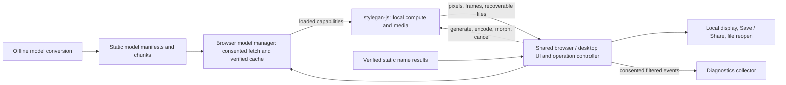

# LATEST PLAN — repo-cleanup-and-architecture-refactor

> **LATEST / ACTIVE PLAN.** This root `PLAN.md` is the single release plan. Scope, technology, visuals, implementation approach, source notes and reviews live here.

Updated: 12 October 2026. Status: **active release planning draft**.
Initiative ID: `repo-cleanup-and-architecture-refactor`. Repository bootstrap complete; application implementation remains unstarted.

Read this file in order, or jump to:
[architecture](#required-repository-architecture),
[language and framework](#language-and-framework-direction),
[Oxfmt/Oxlint](#linting-and-formatting--oxc-tooling),
[conversion Docker environment](#model-conversion-container),
[UI and photo flow](#next-release-ui-and-photo-requirements),
[UI flow gap review](#ui-flow-matrix-and-open-journey-contracts),
[implementation approach](#implementation-approach-and-sequencing),
[source notes](#operator-overview-and-clarifications), or
[review record](#planning-review-and-scope-change-record).

## Goal and source of direction

Finish the sustainable FaceMorph replacement: carry the working Next candidate
forward, retain its existing features and all integrated performance optimizations
with the declared improvements, and retire Triton
and the hosted API on the operator’s decision. Deliver a clearer repository architecture, independently
usable compute/model packages, a reliable classic Docker distribution, repaired
photo encoding and simpler face controls. Engine extraction and autoresearch are
workstreams of this release, rather than its whole scope.

**End result:** the completed monorepo application should offer basically the same
features and working user journeys as `next.facemorph.me` from
`candidate/next-delivery-20260916`, **plus this plan’s additions and improvements**.
The branch baseline identified below governs what is retained. Keep its integrated
performance optimizations, recovery, cancellation and diagnostics through the
architecture refactor. Only the removals or behavior changes explicitly specified
in this plan alter that baseline; features omitted from a workstream’s examples are
still retained. A cleaner repository or extracted engine alone does not complete
this plan if the resulting application loses existing Next functionality.

The operator's [Google Doc overview](https://docs.google.com/document/d/1lVNtTjPOsVYfFUJa0jCiiVU2jtDENcFcQF8iHrufJ1s/edit)
is the new direction. A [dated source snapshot](#operator-overview-and-clarifications) records what
was read, including incomplete/question-mark items and the later pasted clarification.
The supplied [UI archive references](#supplied-ui-references) and
[language/framework recommendation](#language-and-framework-direction) are part of this plan. This plan supersedes conflicting
engine-only choices and older UX requirements for the next release. Existing
nonconflicting identity, correctness, privacy, retention and evidence rules survive.

Repository bootstrap is complete. The new checkout is the continuation point;
classic remains the current delivery/rollback source until application cutover.
No application extraction, TS migration, new CI/domain promotion or classic
Docker/PyTorch qualification is established by the setup.

## Locked original requirements and images

The original operator direction and supplied crop mockups are preserved in a
[local read-only reference bundle](../reference-locks/2026-10-11-original-plan-and-images/README.md).
It contains the exact recovered pre-consolidation plan and companion files,
[operator requirements and pasted clarification](../reference-locks/2026-10-11-original-plan-and-images/original-plan/overview-source.md),
the exact supplied ZIP, all four PNGs, the overview's embedded screenshot and the
first committed consolidated monorepo plan. A manifest records provenance/size/hash;
`SHA256SUMS` verifies the bytes. Do not edit the locked bundle. New original material
gets a separate dated snapshot. Personal-photo images remain local, outside Git.
The raw original DOCX export was not recovered; its captured text and previously
extracted image were recovered. Do not mislabel them as a fresh Google Doc export.

**Design authority:** implement the original crop experience from these references,
with only explicit later operator changes. Reviews may clarify behavior or fix
implementation defects; they do not reopen the visual design by default. The
walkthrough below checks fidelity and fills genuinely unspecified states, rather
than commissioning a replacement crop UI.

- [Confirmation mockup](../reference-locks/2026-10-11-original-plan-and-images/images/crop%20image.png):
  dark Encode an image modal, logo top right, proposed crop, Adjust Crop, Cancel, OK.
- [Adjustment mockup](../reference-locks/2026-10-11-original-plan-and-images/images/crop%202.png):
  existing-style square handles, face/eye guides, rotation, Cancel and Use Crop.
- [Alignment-failure reference](../reference-locks/2026-10-11-original-plan-and-images/images/failed%20to%20align.png):
  retain meaningful guidance and allow manual crop; an eligible confirmed crop
  must proceed to e4e without another successful detection or a repeated crop loop.
- [Original page reference](../reference-locks/2026-10-11-original-plan-and-images/images/recovered%20image.png):
  historical controls; the operator's removals/placement changes still apply.

Latest settled direction: e4e's reconstruction/editability tradeoff is accepted;
keep that encoder. The names picker has the accepted touch Back exit while retaining
its specified headerless, gapless grid. Named-face selection must use a one-time
published complete catalogue, with no selection-time synthesis. This is a design
and architecture plan, not Beads expressed in Markdown. Keep rationale, boundaries,
sequencing and verification here; do not create task IDs, issue states, dependency
records or tracker exports during planning. Conversion to execution work is separate.

## Source names, live surfaces and what each supplies

Use these names in design discussions, reviews and receipts. A repository, a branch and a live
hostname are different identities. In particular, **legacy production is still
current production**; calling it legacy describes its architecture, not its status.

| Name used in this plan | Location / identity | Authority and intended use |
| --- | --- | --- |
| Legacy production web | `https://facemorph.me` before production cutover | Current public UI and useful visual/interaction reference, including its embedded names picker. [application inventory](#application-inventory) must identify its deployed artifact/source; do not infer the deployed revision from a local branch. |
| Legacy hosted API | `api.facemorph.me`, plus `checkface.facemorph.me` surfaces | Current server-backed generation/encoding and API documentation/serving to inventory for retirement. Archived `checkface/` supplies source provenance, not proof of live server bytes. |
| Legacy names site | `https://names.facemorph.me`; sibling `facemorph-names/` | Existing gapless face-grid visual reference and standalone two-selection behavior. Its source calls the legacy API; it cannot remain unchanged after API retirement. |
| Retained application repository | `facemorph.me-classic/`, GitHub repository ID `295956585` | Contains BOTH legacy frontend/server code (`src/App.fs`, `Server/`) and the on-device candidate (`src/Next/`), plus desktop, self-host and research history. The repository's name does not make every file legacy implementation. |
| On-device candidate | `facemorph.me-classic` branch `candidate/next-delivery-20260916`, `src/Next/`; deployed to `https://next.facemorph.me` | Implementation/feature/performance baseline to import and refactor. This is F#/Fable plus JS, not the Next.js framework. Source and recorded live artifact are pinned below. |
| New monorepo | This `facemorph.me/`, GitHub repository ID `1413979666`, branch `main` | Destination for strict-TS application and reusable packages. Currently planning/bootstrap only; no application deploy source yet. |
| Classic self-host distribution | `facemorph.me-classic/self-host/` with its pinned historical frontend and PyTorch API | Separate user-operated Compose product. It is neither the on-device candidate nor proof of what legacy production currently runs. |

Precedence: latest operator instructions and explicit planned UX changes; then
the named visual reference for that interaction; then on-device candidate behavior
for everything retained. Legacy production/names are valid UI references without
requiring old HTTP semantics, result URLs or server-generated pixels in the new app.
For every UI discrepancy [package and operation contracts](#package-and-operation-contracts) records **reference → deliberate change → acceptance**.
Do not describe the source of a change merely as “old app,” “current app” or “Next.”

Observed read-only on 11 October 2026: legacy production has two face inputs,
per-input Browse Names, and an embedded picker with a dark “Select an Image” header
and X. The standalone names site renders the edge-to-edge labelled grid without
that header. The new picker takes the grid as its visual reference and deliberately
removes the embedded header/X under the operator's existing instruction. These are
live UI observations, not a deployment-source attestation or new inference test.
The production notice still announces a fixed October 25 retirement date; update
that active copy when executing delivery work to match operator-controlled timing.

## Programme boundaries and finish line

“Architecture programme” means the following concrete deliverables, not a new
requirement to keep the API running until all of them finish:

| Track | Deliverable | Completion is established by |
| --- | --- | --- |
| Repository identity | Organization rename and repaired repo/integration references | [organization rename execution](#organization-rename-execution), stable repository IDs and checked active links/integrations. Can be the first execution work after a small identity inventory. |
| Product migration | Import candidate; translate UI/state to TS/React; move delivery to Vite; implement specified photo/face/names UI | The intended UI/photo/names behavior works in the final app; see [integrated verification](#integrated-verification). |
| Reusable architecture | Compute/media/morph engine; browser model manager; model hosting tools; conversion container | Independent consumers work for the documented compute, media, model-management, hosting and conversion capabilities; distribution checks pass. |
| Classic distribution | Documented fresh-clone GPU Compose with original UI/API | [classic distribution](#classic-distribution) and a publication receipt; stays in the retained application repository. |
| Delivery and retirement | Candidate-source handover, production promotion, legacy API retirement, package publication | Separate [delivery and publication](#delivery-and-publication) substeps; each records only what actually shipped or stopped. |
| Further optimization | Frozen workloads and evaluator for future improvements | [research workload design](#research-workload-design)/[research evaluator](#research-evaluator); separately completable research, not a release prerequisite. |

The completed system works as follows:



On desktop, the host adapter can supply qualified native inference/model handles
instead of browser handles; product behavior stays shared. Static model/name
hosting and diagnostics remain online services. Inference runs on the user's
device. Classic Compose is separate: a user operates the historical frontend/API
and PyTorch inference on their own NVIDIA host. Model conversion runs at build /
publication time, never as part of a visitor's normal generation flow.

Default implementation order: [source and repository identity](#source-and-repository-identity)'s small identity/source map, [organization rename execution](#organization-rename-execution) organization
rename/link repair, remaining inventory and [package and operation contracts](#package-and-operation-contracts) contracts/design, [workspace build and artifact identity](#workspace-build-and-artifact-identity) build,
then ordered migration/extraction and final product checks. Independent conversion,
hosting and classic work can follow their own dependencies. No org rename changes
the candidate branch, switches a domain, promotes a build or retires an API.

There are two distinct hosting handovers: (1) `next.facemorph.me` changes its build
source from the retained candidate branch to the qualified new monorepo; (2)
`facemorph.me` changes from legacy production to the chosen on-device artifact.
Either receipt names repository ID, branch/commit, artifact and hostname. During
handover only one repository's deployment workflow may publish to a given target;
disable/rebind the old publisher when switching, so a later classic branch push
cannot overwrite the new monorepo. Retain the prior artifact/configuration for
ordinary site rollback. Early promotion of the retained candidate is also allowed
and does not mean the new monorepo or architecture programme is complete.

## Starting facts and boundaries

- New initiative checkout: `facemorph.me/`, origin `github.com/check-face/facemorph.me`,
  default branch `main`, fresh repository ID `1413979666`. This is the continuation
  point for the monorepo plan; it has no application build or deployment yet.
  Repo creation, local directory rename, plan publication and workspace setup
  are complete. Sibling `facemorph-names/` and `encoder4editing/` are also cloned;
  `fm-control/` and `fm-direct/` are retained historical benchmark copies.
- Retained application/source checkout: sibling `facemorph.me-classic/`, origin
  `github.com/check-face/facemorph.me-classic`, ID `295956585`, branch
  `candidate/next-delivery-20260916`. Existing candidate delivery remains
  `https://next.facemorph.me` until a qualified new-monorepo cutover.
- Source reviewed for planning: `b2d945a8c7f0ff9f382fbfefaecc2651943077a3`; recorded verified delivery:
  `001ba853b277775a060030a3ab23a3900af28f16`, build `next-04403766fff8630a`.
  [Receipt](https://github.com/check-face/facemorph.me-classic/blob/b2d945a8c7f0ff9f382fbfefaecc2651943077a3/docs/plans/feedback-delivery-2026-10-11.md). Reverify before a new comparison;
  neither current checkout nor a rebuilt artifact is automatically the live control.
- `src/Next/` uses F#/Fable plus JS runtime/worker/media modules. The product bridge
  currently mixes application and compute orchestration. Package extraction must
  split responsibilities, not relocate the entire singleton.
- `self-host/` already has a pinned original frontend, a PyTorch-based NVIDIA
  runtime and Compose packaging. Its Dockerfile clones the current GitHub repo
  at a historical commit. Reconcile this implementation before porting duplicate
  server work. Candidate commit `b2d945a8c7f0ff9f382fbfefaecc2651943077a3`
  already repairs the Dockerfile/README clone URLs for the repository rename;
  inspect default-branch and remaining integration references separately.
- The sibling `checkface/` is the legacy backend. Inspect it read-only for migration
  provenance. Its remote is already archived as-is (ID `185985766`); history
  remains readable/cloneable. Do not re-archive or rewrite it.
- Model staging still consumes selected old lab inputs and external artifacts.
  Do not delete `experiment/` or move production weights without an input inventory.
- Preserve other sessions' `.gitignore` / `.cloudflare/` and `desktop/README.md` work. No worktrees, branch
  resets, cleanup of concurrent edits or inclusion of another session's changes.

Current commands in the retained classic checkout are `npm run build:next` and the existing exact-artifact/UI/device
harnesses. Current CI uses Node 22, .NET 5 and pinned Fable tools. The migration
keeps top-level build/verification commands as stable wrappers while paths change.
Use [development](https://github.com/check-face/facemorph.me-classic/blob/b2d945a8c7f0ff9f382fbfefaecc2651943077a3/docs/dev/README.md), [research protocol](https://github.com/check-face/facemorph.me-classic/blob/b2d945a8c7f0ff9f382fbfefaecc2651943077a3/autoresearch/program.md)
and [record standards](https://github.com/check-face/facemorph.me-classic/blob/b2d945a8c7f0ff9f382fbfefaecc2651943077a3/autoresearch/records.md) for current procedures.

## Existing Next implementation and feature disposition

**Build from the existing Next candidate, not from an empty product specification.**
The reviewed implementation is in `../facemorph.me-classic/` on
`candidate/next-delivery-20260916`, source commit
`b2d945a8c7f0ff9f382fbfefaecc2651943077a3`. Repo rename changed its location/name,
not its Next code. New `facemorph.me/main` currently contains planning/entry guides
and tracker export only; it does not yet contain this application. Import/extract
the candidate with source provenance. Classic `src/App.fs` and archived backend
are historical comparison/migration inputs, not the product to recreate in Next.
Legacy production and names still supply the explicitly named UI references above;
retaining candidate functionality does not make candidate visuals the sole reference.
Code inspection establishes implementation presence, not a new live-device result;
the recorded delivery receipt in Starting facts remains separate.

**Preservation requirement:** import and refactor this candidate, retaining its
existing features unless this plan explicitly changes or removes them. Carry
forward **all integrated performance optimizations**, not merely equivalent
outputs. Preserve the existing CPU/WebGPU execution paths, bounded worker/frame
pipelines, model acquisition/checksum/cache recovery, warm reuse, background image
encoding and compressed session/video/scrub restoration. Package extraction and
the TypeScript/React/Vite migration must not replace these with slower generic
paths, repeat inference on restore, or add avoidable encoding/readback/downloads.
If an optimization needs a different implementation at a package boundary,
preserve its benefit and explain and check the replacement against the candidate;
do not silently discard it. Apply declared UX changes on top of that baseline.

Recent candidate work includes mobile controls and crop geometry fixes, background
WebP retention with PNG fallback, bounded compressed multi-face/video/scrub session
recovery, and corrected asynchronous retention checks. The
[11 October delivery note](https://github.com/check-face/facemorph.me-classic/blob/b2d945a8c7f0ff9f382fbfefaecc2651943077a3/docs/plans/feedback-delivery-2026-10-11.md)
records that work and its verification. Keep these fixes and the earlier integrated
performance work; this short note is a baseline reference, not an exhaustive file
map. Research prototypes and experiment results that were not integrated remain
research evidence, not features to promote automatically. Neither implementation
presence nor reduced work alone establishes a measured whole-journey speedup.

### Deep feature coverage audit

This is a disposition of features found in classic, backend, names and the existing
Next branch. Preserve existing Next features and integrated performance optimizations, except
for the explicit changes/removals in this plan. It does not require matching historical server pixels, URLs or every API
parameter. Computational correctness and exact exported latent/provenance integrity
remain requirements; deliberately different UX is not an accidental regression.

| Feature found in historic sources / Next | Disposition for this release |
| --- | --- |
| Words/names and numeric seeds | Already local in Next. Keep deterministic supported input behavior, validation and default previews; no old-output byte-parity programme. |
| Photo encoding | Already local in Next through e4e. Repair confirmed-crop loop, proposed/adjustable crops, paste equivalence and ordered multi-face insertion under [confirmed-crop encoding](#confirmed-crop-encoding)/[face controls and modals](#face-controls-and-modals). |
| Two-face and multi-face morphs | Already Next. Keep add/remove, ordered controls, mixed photo/generated/restored inputs, current shape modes and useful endpoint reuse. A direct reordering control was not found in the reviewed candidate UI and is explicitly out of scope; retain insertion/removal order without adding reorder UI. |
| Linear, ellipse, figure-eight, smooth paths; pinch/width/length | Already implemented in Next geometry/UI. Carry forward supported controls and meanings; no need to expose every historical HTTP interpolation parameter. |
| Video playback and slider scrubbing | Already Next, with one visible result at a time and available-frame feedback. Keep loop/inline playback, slider choice and retained-frame behavior. |
| Image/MP4 Save and Share | Already Next; `shareMedia` uses the same metadata-bearing export as Save. Improve action prominence/format choice, not a replacement URL-sharing service. |
| PNG/WebP latents and MP4 project metadata | Preserve still-image reopening without photo re-encoding, exact metadata and model incompatibility checks. Keep MP4 metadata/readers and retained-session playback; external MP4 project-opening UI is explicitly deferred. |
| Raw-pixel lossless library helpers | Planned engine API. Do not confuse the library's required PNG/lossless-WebP support with the app's existing acceptable lossy-WebP policy. |
| Project JSON helpers | Existing internal/hidden Next implementation. Keep the schema for embedded MP4 recovery; do not restore a separate project toolbar as a prerequisite. |
| Names catalogue and picker | Candidate has catalogue/previews/latents, but selection currently runs synthesis. [static names and picker](#static-names-and-picker) adds a borderless fullscreen picker with verified ready-made results and no inference on selection. Refine the existing fullscreen modal using the legacy names grid as visual reference; no names-only route or old networking contract is required. Generic `names.facemorph.me` entry may lead to the main app, without result-bearing share URLs. |
| Standalone names two-choice entry / old iframe messaging | Convenience can use local Next selection state; do not preserve cross-app iframe/API contracts or construct a shared morph URL. In-app single selection remains instant as already specified. |
| CPU/WebGPU selection, acquisition and caching | Already Next. Move selector, modalize download consent, remove WebGL, retain verified caching/retry and bounded fallbacks. |
| Cancellation, queue/progress, per-face retry | Existing Next primitives; planned per-slot/multi-face behavior extends them. Retain completed results and reject stale results. |
| Session restore, file drag/drop/paste | Existing Next recovery/local state. Keep compatible recovery within an origin; production starts fresh, with no Next-to-production storage migration. |
| Slow-device guidance, estimates and error handling | Already Next. Keep truthful provider/status/estimates and retry guidance; replace “Use classic FaceMorph” links after public classic/API retirement with Docker self-host guidance. |
| Diagnostics and analytics | Already Next. Keep privacy filtering, consent, one-shot Send this report, report reference and non-blocking failures; rebind hosts/routes for production. |
| Old GUID/photo/morph links and Mongo archive | Retired by operator. No resolver, preservation migration or public personal-media archive. |
| Share/copy links, SSR previews and oEmbed | Retired. No result URLs, dynamic link previews or hosted generation for social crawlers. Share actual recoverable files. |
| Public face/hash/registerlatent/frame/encode/GIF/WebP API endpoints and extension | Retired publicly. Useful API workflows remain available only through users' own classic Compose installation. No hosted compatibility layer. |
| GIF / animated WebP / JPEG export in the new UI | Optional future formats, not required to retire the API. Start with existing WebP, PNG and MP4; any added format must embed and recover the relevant latent/project data. |
| Hosted HF trial/account/quota flow | Superseded historical experiment. No sign-in, HF entitlement or owner-funded inference service in the new product. |

### File sharing and export direction

Use **Share** as the primary completed-result action, with **Save** and a compact
format choice beside it. Default to the candidate's current recovery-bearing WebP
for a face and MP4 for a morph; offer PNG for lossless still-image export. Keep
MP4 as the first animation format rather than adding a new codec requirement.
Do not auto-open the system share sheet after generation; sharing is a user action.
Prepare the selected file before enabling its Share action, so the click can invoke
`navigator.share({files})` within the user gesture. Unsupported/failed file sharing
falls back to downloading that same file; user cancellation keeps the result ready.
Save remains directly usable on desktop and when system sharing is unavailable.

**Filenames (operator ruling):** use short, informative defaults from the result's
name, entered text, seed or source-file basename. Examples of the intended form:
`emma-k4p7s2.webp`, `seed-42-j8m3r6.png`, `holiday-face2-v9d2h5.webp`,
`emma-noah-linear-c6q8t3.mp4` and `emma-noah-figure8-b7w4n2.mp4`.
These suffixes are illustrative, not prescribed identities. Preserve a recognizable
short label; for longer paths use the first/last label plus a face count. Include
the morph mode and distinguish selected crops. Strip the source extension, path
components, control/bidi characters and filesystem-reserved characters/names;
normalize whitespace and truncate the descriptive part before the distinguishing
suffix (target at most 64 characters before the real output extension). Use `face`
or `morph` only when no informative label exists. Let the user edit the proposed name
without adding a mandatory naming dialog; preserve the automatic disambiguator.

Different export identities must get different suggested filenames, including
different crops, ordered inputs, morph modes/settings, models and encoding options.
Derive a short suffix from stable export identity and detect/extend collisions in
the app's known export set; labels alone, timestamps alone and slot numbers are
insufficient. Repeated Save/Share of the same prepared file reuses its name. Preserve
identity through restoration so a changed result is not mistaken for the old file.
The extension and MIME must match the actual WebP/PNG/MP4 bytes, including native Save.
A browser cannot inspect arbitrary existing Downloads files: ordinary downloads
leave duplicate handling to the browser; native/file-picker writes must use
no-clobber naming or explicit overwrite confirmation. Do not claim absolute
cross-device/filesystem uniqueness from a short suffix or silently replace a file.
Show the proposed filename with the prepared export. Informative filenames are
visible to share recipients; they do not authorize adding text/source names to
embedded recovery metadata or diagnostics.

Every app-generated file offered through Save or Share includes recoverable latent
and model/provenance metadata. Morph files include the ordered controls and morph
settings needed to reconstruct the project; no raw source photos, typed words,
original filenames or diagnostics are embedded. Metadata inclusion is the default
and is not removed by a “social” preset. Preserve legacy PNG/WebP/MP4 readers.
Only label a new format supported when export plus validated metadata-reader round-trip
works (and still-image UI reopening works); do not silently export a metadata-free JPEG/GIF as a convenient fallback.
If a receiving app recompresses or strips metadata, the untouched downloaded/shared
file remains the recovery source; we cannot promise third-party copies preserve it.
A small format description can say “Includes editable face data,” without another
confirmation flow. Still images use the existing per-face file/photo entry. External MP4 reopening
and project-import UI are deferred; keep MP4 export/playback and internal metadata
readers without adding a project toolbar or import completion gate.

[media and recovery](#media-and-recovery) owns container metadata/export format correctness; [face controls and modals](#face-controls-and-modals) owns Share/Save /
format controls and user-gesture handling. Additional codecs are optional after
the three existing format paths are usable. This keeps the default simple and
reduces work needed to finish the project.

### Diagnostics that must survive the move

Reuse `analytics.mjs` and `reporting.mjs`: actual provider, operation/outcome/stage,
bundle/source identity, bounded performance metrics, consented report references,
retry/fallback and export-format outcomes. Preserve privacy allowlists, DNT/GPC
behavior, staging until consent and one-shot Send this report; never record photos,
latents, typed inputs or raw error strings. Keep failures non-blocking.
`analytics.mjs` currently scopes tracking to `next.facemorph.me`, while
`reporting.mjs` posts to `https://next.facemorph.me/diagnostics/events`: update their
host/route configuration deliberately for production, and keep collector bindings
independent of Triton/API retirement. Check that a consented sample reaches the
collector and a declined/blocked sample does not prevent generation. No iPhone
pass, analytics success rate or diagnostics-derived score controls cutover.

## Required repository architecture

| Surface | Required end state | Migration constraint |
| --- | --- | --- |
| GitHub organization | Rename `check-face` to the selected compliant login `facemorph-me` (brand: FaceMorph.me). | Verify the actual available/valid organization login and permissions. `facemorph-me` is the chosen URL login; verify availability/permissions at execution. `facemorph.me` remains the product/domain brand. |
| `facemorph.me-classic` | Complete/qualify the legacy server and original frontend with PyTorch and easy Compose. | Repository rename is done; preserve history, pinned frontend commit, API behavior, model sources and attribution. |
| Existing fresh `facemorph.me` repository | Implement monorepo with UI, engine, model manager, model-host tooling and model converter. | Establish source provenance, package boundaries, CI, deployment pins and a rollback route before cutover. |
| Triton, `api.facemorph.me`, `checkface.facemorph.me` | Retire hosted inference and both old API hostnames completely. | Operator chooses timing; Next keeps working, diagnostics/models/names remain, and users may self-host classic Compose. No GUID/link archive or compatibility API. |
| npm publication | Publish the reusable engine; resolve real npm names/scope when publishing. | Working folder names are not reserved package names. Pack/smoke-test first; ship no pretrained weights. |

Target layout for the new monorepo:

```text
facemorph.me/
  PLAN.md                          # stable latest-plan pointer
  apps/web/                        # TypeScript/React UI and application policy
  packages/
    stylegan-js/                   # compute, morph geometry, image/latent metadata
    browser-model-manager/         # chunks, checksums, OPFS/cache, loaded handles
    cloudflare-model-host/          # reproducible model-chunk hosting tools
    model-conv/                    # pretrained StyleGAN2 conversion tooling
  autoresearch/                    # frozen workloads, evaluator, candidates, ledger
  docs/plans/repo-cleanup-and-architecture-refactor/ # future contract/inventory/qualification outputs
  scripts/                         # aggregate build/qualification/identity tools
  package.json / package-lock.json  # npm workspaces and pinned dependencies
  tsconfig.base.json               # shared strict TS policy; scoped target configs
  desktop/                         # retained native host integration as applicable
  photo-runtime/                   # retained native/WASM preparation toolchain
```

Use npm workspaces for JS package linkage because npm/lockfiles already exist;
do not add another package manager or orchestration framework merely for layout.
Python conversion/build dependencies can remain Python tooling within their owner.
[Workspace contract](https://docs.npmjs.com/cli/v11/using-npm/workspaces/).
Source paths throughout the implementation approach refer to the retained classic checkout
until inventoried and imported into the new monorepo; they are not already present
in this fresh repo. Source/history transfer still needs [application inventory](#application-inventory) inventory; the
completed bootstrap does not authorize abandoning existing branches or evidence.

The old repository path is already occupied by the fresh repo: old redirects
cannot be relied upon. Prepare artifacts and manifests before the remaining
organization/integration/domain cutover.
Update Dockerfile historical clones, remotes, Actions references, badges, docs,
webhooks and Cloudflare integration explicitly. GitHub does not redirect every
surface, including reusable action calls and Pages URLs.
[Repository rename rules](https://docs.github.com/en/repositories/creating-and-managing-repositories/renaming-a-repository),
[organization rename rules](https://docs.github.com/en/organizations/managing-organization-settings/renaming-an-organization).

### Organization rename first: known reference changes

[organization rename execution](#organization-rename-execution) can run before application migration; its prerequisite is only [application inventory](#application-inventory)'s
identity/link inventory, not [integrated verification](#integrated-verification) or [classic distribution](#classic-distribution). Read-only GitHub checks on 11 October
2026 found the five repositories below under `check-face` and an active admin org
membership for the authenticated operator. `users/facemorph-me` returned 404;
this is not a reservation or proof GitHub will accept the name. Verify availability
in the rename flow when executing. No organization mutation occurred in this review.

| Repository | Stable ID | Intended URL after organization rename |
| --- | --- | --- |
| New monorepo | `1413979666` | `github.com/facemorph-me/facemorph.me` |
| Retained application | `295956585` | `github.com/facemorph-me/facemorph.me-classic` |
| Archived backend | `185985766` | `github.com/facemorph-me/checkface` |
| Legacy names source | `348379171` | `github.com/facemorph-me/facemorph-names` |
| Encoder fork | `368806700` | `github.com/facemorph-me/encoder4editing` |

Known active references from this workspace scan (paths below belong to
`facemorph.me-classic/` unless another repository is named):

| Reference | Required disposition |
| --- | --- |
| All five local `.git/config` origins; maintained README/AGENTS/plan links | Update org prefix, preserving each repository's identity. Do not rename the classic checkout back to the new monorepo name. |
| `hosting/next-static/promote.py`, `REMOTE` and workflow-source validation | While promoting retained candidate artifacts, use `facemorph-me/facemorph.me-classic`; new-monorepo promotion uses its own repo ID/source. The present `check-face/facemorph.me` already names the wrong repository. |
| `self-host/Dockerfile`, `self-host/README.md` clone and Actions URLs | Use the renamed classic URL and explicit distribution branch/pinned historical frontend commit. Check fresh clone still resolves that commit. |
| `src/Config.fs`, `self-host/frontend-overlay/source/src/Config.fs` source links | Classic builds link to classic; new app links to monorepo. |
| `src/Next/product-bridge.mjs` `ISSUE_REPO`; `src/Next/Product.fs` desktop documentation link | Keep candidate bug-report/source links pointing at its actual repository until the new app handover; provide the destination issue template. |
| `desktop/scripts/prepare-release.mjs` updater endpoint; `desktop/tests/packaging.test.mjs` expectation | Name the repository that actually hosts signed update releases. Default is classic until an explicit updater migration; do not point installed clients at an empty fresh repo. |
| `.github/workflows/research-built-ui-media-v1.yml` retained-run artifact lookup | If still runnable, resolve the existing run in classic by repository ID; frozen evidence keeps original bytes and gets a lookup mapping rather than historical rewriting. |
| `self-host/frontend-overlay/source.json`, `self-host/REPOSITORY-PROVENANCE.md`, historical Actions/source links | Distinguish immutable original provenance from a current clone URL. Add current resolution mapping; do not pretend an old commit/run belongs to the fresh repository. |
| `src/explain.md`, API FAQ/retirement copy, repository homepage fields | Update active navigation/source links for their actual product; API removal and names redirect are delivery work, not an effect of GitHub rename. Archived backend content remains as-is. |
| Cloudflare GitHub app/project connections, webhooks, Actions permissions/variables, any OIDC subject restrictions, package/container owner paths; names hosting connection | External configuration inventory required. These were not inspected by the source scan. Confirm owner/repo IDs and branch bindings; avoid recreating shared secrets or assuming reconnect is necessary. |

GitHub's current organization-rename documentation says repository links normally
redirect, but the old organization name can be reclaimed and redirects overridden.
Update active remotes and integrations explicitly. Existing wrong-repository links
caused by the earlier repository rename need a **repository-name correction too**.
Search tracked code/config and maintained docs for `check-face`, GitHub/raw/codeload /
release URLs, `gh -R`/API paths and workflow `uses`; classify each hit before edits.
Do not mass-rewrite frozen reports, model identity digests or archived backend code.

Rename acceptance: same five repo IDs/archive/default-branch states; new URLs and
historical commit resolution work; intended Actions/app connections still identify
the right source; active source/help/updater/clone links resolve. Check currently
running production and candidate remain at their existing domains/artifacts. Any
changed build gets its normal checks before publishing; a rename is not a deploy.


### Retire hosted inference and the old API completely

The end state is on-device FaceMorph, with no project-operated Triton, photo encoder
API or legacy generation API. Both `api.facemorph.me` and `checkface.facemorph.me`
are retired completely: no API replacement, static artifact API, GUID resolver,
result-link redirect or legacy proxy remains at those hostnames. Self-host users
can run their own frontend/API through `facemorph.me-classic` Docker Compose.
Model chunks, the public names catalogue and consented diagnostics remain hosted
services; they do not provide inference or store user-shared results.

Old Mongo GUIDs, uploaded-photo links and historic morph URLs are deliberately
unsupported. Do not build an archive/resolver, migrate production Mongo data,
rehost personal latents/media, or gate cutover on preserving those records. This
ruling does not itself authorize deleting production data: any later data disposal
is a separate explicit operation. Existing source/history stays archived.

`facemorph.me` starts fresh. No transfer of IndexedDB, OPFS, model caches, preferences
or session state from `next.facemorph.me` is required. Ordinary file-based recovery
continues to work; existing compatible on-origin cache behavior remains useful.
Do not add cross-origin cache bridges or a complex migration wizard.

October 25, 2026 is aspirational. The operator chooses when to promote the candidate
and retire the API. There is no automatic deadline shutdown, historic-service
parity gate, required phone/iPhone test pass, or separate full shutdown-qualification
campaign. [integrated verification](#integrated-verification) checks the intended app works with available relevant checks and
that diagnostics remain usable; missing device evidence is recorded, not a veto.
The operator may cut over the existing working candidate before every architecture /
package/research workstream is finished. Report what is actually complete.

[domain handover and retirement preparation](#domain-handover-and-retirement-preparation) inventories the specific Triton/encoder/API processes, tunnels/proxies, DNS /
Pages bindings and dedicated credentials to retire, distinguishing them from model,
names and diagnostics hosting. It prepares concise commands and remaining active
app reference changes. [delivery and publication](#delivery-and-publication) executes the operator's chosen promotion/retirement
sequence, records which actions occurred, and confirms the new site still serves
its app/models/catalogue and diagnostics. This is ordinary delivery verification,
not a historic-service parity or phone-readiness certification.
Remove the old API hostnames, serving routes and API-only infrastructure; preserve
shared resources still used by model assets, names or diagnostics. Update public
retirement copy: old GUID/results/links will not be preserved, no new share URLs
exist, and the operator controls timing. Do not carry forward the older promise
that every historic link must be reachable before shutdown. No live retirement or
data deletion is performed by this planning update.

## Browser and desktop alignment ruling — 11 October 2026

Operator direction: keep browser and desktop/Tauri aligned. This is an accepted
architecture and product ruling; native raw transport is not implemented or
qualified by recording it.

- Share the UI, application state, input/crop flow, display, morph scheduling,
  media preparation, metadata/recovery and retention policy by default. A product
  improvement must cover each supported host or record its specific limitation.
- Select optimized paths through explicit runtime/host capabilities, not blanket
  `__TAURI__` exclusions. Both adapters must expose the same operation/result,
  cancellation, error, progress and resource-ownership contracts. Supported
  capabilities and qualified providers may differ and must be reported honestly.
- Raw RGBA display, deferred file encoding and bounded direct frame delivery are
  the shared target where supported. Preserve encoded-result/cache compatibility
  and bounded fallback. Do not add an encode/decode round trip solely because the
  host is desktop, or move browser timing claims onto native IPC without evidence.
- Keep platform differences within adapters for native inference/model access,
  IPC, file dialogs, OS save/share and lifecycle. Any further divergence needs a
  documented capability restriction or measured correctness/resource/performance
  reason, an owner and a revisit gate. A host-name check alone is not justification.
- [package and operation contracts](#package-and-operation-contracts) inventories current host checks and freezes capability/result contracts,
  including raw-buffer dimensions, byte bounds, ownership, deferred file readiness
  and frame acknowledgment. [morph pipeline](#morph-pipeline) applies those contracts during extraction.
  [integrated verification](#integrated-verification) checks the same supported product journeys in the exact browser and
  installed Tauri artifacts, plus cancellation, fallback, recovery and bounded
  memory/queues; unsupported or untested cells remain explicit. Native IPC transfer
  and encoding must be measured before assigning native performance claims.

Current gap: `desktop/runtime.mjs` reads `result.json` and `image.png` from a native
artifact and returns an encoded Blob; it has no raw-result or `synthesizeFrames`
contract. `src/Next/product-bridge.mjs` disables raw face/photo and streamed morph
paths with Tauri checks. This is an older implementation boundary, not evidence
that raw RGBA/canvas is slow or unsuitable on desktop. Existing native CPU and
shell evidence remains scoped to its tested artifacts; this ruling does not
expand desktop release support or start deferred native GPU work.

## Language and framework direction
Recommendation for `repo-cleanup-and-architecture-refactor`: **strict TypeScript, React and Vite**
for the new web application; framework-independent TypeScript for reusable browser
libraries and JS hosting interfaces; **Python/PyTorch** for model conversion and the
classic API. npm workspaces manage JS packages. This is a grounded planning choice,
not an implemented migration or a performance claim.

### Why this fits this repository

The existing UI in `src/Next/Product.fs` is Elmish/Fable over React, with crop/photo
state, names routing and bridge calls. `package.json` currently uses React 17 and
Webpack, while runtime/media modules are JavaScript. Moving to TS/TSX and React
preserves the component/DOM model and removes Fable from the new app when parity is
proven. A simultaneous move to another component framework offers no established
compute benefit and makes required interaction parity harder to verify.

The next app executes inference locally and deploys static bytes with production
headers. It has no current need for server rendering, server actions or a hosted
application API. Vite fits that static SPA, worker bundling and npm-workspace setup.
React's official guidance generally recommends a framework, but also documents
React + Vite for projects with specific constraints. We accept responsibility for
routing, code splitting, error recovery and ordinary deployment checks rather than assuming
Vite supplies them. Inventory the remaining real routes before choosing routing
dependencies; the fullscreen names picker is modal state, not a required `/names`
route. Use lightweight browser-history handling or React Router declarative mode
only where actual app navigation warrants it. Preserve Back dismissal and still-file recovery. Result-sharing URLs,
old GUID/query links, dynamic previews and oEmbed are intentionally retired.

Use React local state for local widgets and pure typed reducers for face preparation,
selection and job transitions. Operation services own abort/disposal and request
revisions; React render/effect lifecycle must not own hidden model downloads.
Typed discriminated unions make invalid state transitions visible and help prevent
crop-confirm loops. Avoid a global-state framework until an actual shared-state
requirement justifies it. Keep high-frequency frames/progress in bounded worker /
service pipelines and throttle displayed updates; React only renders product state.

### Alternatives considered

| Option | Fit and decision |
| --- | --- |
| TypeScript + React + Vite | Recommended. Existing React semantics, static delivery, explicit package/worker boundaries and incremental parity checks. |
| TypeScript + Svelte + Vite | Credible for a greenfield UI; compiler-based components may be convenient. Here it adds a second component/state migration with no measured end-to-end benefit. Revisit only with a bounded parity/performance prototype. |
| Next.js | Supports static export, so it is possible. Its server-oriented features do not solve the present local-inference requirements; additional conventions and static-export constraints offer little benefit for this release. Revisit if real server-rendered content becomes a product requirement. |
| Retain F#/Fable | Lowest immediate visual-migration risk; useful as the measured control and temporary facade host. New product/package code is idiomatic TS. Retirement is a separate parity-qualified step, not a blind file translation. Classic retains its pinned original UI. |

### Monorepo language/build contract

- `apps/web`: TS/TSX + React + Vite; routing only for inventoried navigation needs. Product styles
  and accessible modal/focus behavior match the supplied references; adopting a
  new UI kit or generic redesign is not a prerequisite. Assess any crop component
  for touch/rotation/coordinates/maintenance against the actual required interactions.
- `packages/stylegan-js`: strict TS, no React/Vite dependency in its public API;
  ESM JS plus generated `.d.ts` and explicit exports. Typed model/latent/media /
  worker contracts, dependency injection for loaded capabilities, no model resources.
  Worker entry points are explicit emitted JS exports with tested bundler loading;
  a consumer must not need the app's Vite aliases or filesystem layout.
- `packages/browser-model-manager`: strict TS browser services for manifests,
  verified chunks, OPFS and loaded handles. Browser-only features have explicit
  capability failure; importing the module does not access globals or start I/O.
- `packages/cloudflare-model-host`: TS public CLI/interfaces where JS tooling is
  appropriate; retain verified Python staging behind documented adapters during
  extraction rather than rewriting it for language uniformity. No UI/React runtime.
- `packages/model-conv`: Python/PyTorch conversion core with pinned environments,
  numerical checks and documented CLI; optional TS wrapper is convenience only.
  Model/tool ecosystems justify Python here. Generated shader/WASM/native code
  remains in its appropriate language and owner; TS is the orchestration language.
- Classic repository: preserve original frontend and Python/PyTorch API/Compose;
  this release does not rewrite that original UI into React/TS.

Use a root base TS configuration with `strict`, `noUncheckedIndexedAccess`,
`exactOptionalPropertyTypes`, `isolatedModules` and type-only imports. Scope DOM,
WebWorker and Node type environments separately; shared contracts must not acquire
accidental DOM/Node globals. Validate `unknown` manifest/metadata/worker values at
runtime rather than trusting erased TS types. No broad `any`, unchecked casts or
silent defaults to make migrated code compile. Temporary JS interop uses narrow
adapters with tests and a named retirement owner; do not mechanically rename `.mjs`.

CI must run explicit TS checking separately from Vite build, since Vite transpiles
but does not type-check. Use package declaration builds and no-emit checking for
app/adapters with workspace dependency ordering. Clean pack/install tests include
public types, emitted worker assets, export resolution and a consumer outside the
monorepo. Keep runtime imports free of repository-only path aliases.

Pin stable dependency versions/lockfile and Node compatibility in [workspace build and artifact identity](#workspace-build-and-artifact-identity); do not
fetch `latest` at build time. Vite's browser defaults are not a CPU-route support
policy: set and verify app/worker targets for the declared browser matrix. Retain
production COOP/COEP/CORS, WASM/worker/runtime integrity, exact artifact hashing,
static route fallback and qualified-byte promotion. No bundler upgrade is a speed
win until fixed first/nth visit workloads measure it.

### Linting and formatting — Oxc tooling

Use **Oxlint** for authored JS/TS/JSX/TSX linting and **Oxfmt** for formatting
supported authored source/config/docs. Their shared tool ecosystem keeps the TS
monorepo tooling small and consistent. This is a planned [workspace build and artifact identity](#workspace-build-and-artifact-identity) deliverable; no
packages, configuration or scripts are installed by this planning addition.

Pin `oxlint` and `oxfmt` as root development dependencies in the npm lockfile.
Use one root `.oxlintrc.json` and `.oxfmtrc.json`, with explicit file overrides /
ignore patterns and editor instructions. JSON configs keep tool configuration
independent of TS config-loader/runtime assumptions. Pin a compatible Node version;
registry metadata checked for this pass requires Node `^20.19.0 || >=22.12.0` for
both current tools. Select/test exact versions during [workspace build and artifact identity](#workspace-build-and-artifact-identity) rather than using
`npx ...@latest` in CI.

Planned root scripts:

| Script | Behavior |
| --- | --- |
| `lint` | `oxlint --deny-warnings`; read-only lint gate over declared authored roots. |
| `lint:fix` | `oxlint --fix`; explicit local safe-fix operation. |
| `format` | `oxfmt`; explicit local write-mode formatting. |
| `format:check` | `oxfmt --check`; read-only formatting gate. |

Oxlint's native TypeScript and verified React/hooks rules apply with environment
overrides for browser UI, workers and Node tooling. Enable correctness rules and
bounded, justified suppressions rather than a blanket disabled legacy ruleset.
Keep package-boundary/worker/artifact checks: linter coverage does not establish
transitive dependency isolation, numerical correctness or complete type checking.
TypeScript checking remains a separate gate. Select rules supported by the pinned
Oxlint release; any additional type-aware lint mode needs its own verified setup.

Oxfmt uses a shared style (100-column width, two-space indentation); leave automatic
import/package-field reordering off initially so formatting does not introduce
side-effect ordering changes. Include authored app/package files, maintained
scripts, configs and current docs; exclude dependencies, generated Fable outputs,
build/distribution assets, vendored code, weights, fixtures, execution-tracker state/export,
and immutable historical scripts/reports identified by [application inventory](#application-inventory). Exclusions name frozen
artifacts rather than hiding all future autoresearch code or maintained adapters.
Python, F#, Rust and shader formatting is outside these tools' declared scope.

Introduce the style baseline in a separate formatting-only revision; rule fixes
and behavioral refactors stay independently reviewable. CI runs `format:check`,
`lint` and explicit TS checks before build/qualification, without writing fixes.
[workspace build and artifact identity](#workspace-build-and-artifact-identity) acceptance: supported file roots are discovered, ignored frozen/generated
bytes stay unchanged, deliberate formatting/lint violations fail the relevant check,
formatting twice is idempotent, and CI/local/editor invocations share the pinned
configs. [integrated verification](#integrated-verification) retains these gates for release artifacts.

### Model conversion container

[conversion tooling](#conversion-tooling) supplies a reproducible Docker environment under `packages/model-conv`,
with a Dockerfile, pinned Python/PyTorch/export dependencies, `.dockerignore` and
an opt-in Compose conversion service. This avoids host-specific virtualenv setup
and records the actual toolchain used to create provider artifacts. Container
builds include converter code/tools and notices, **no pretrained weights**.

Document build, conversion and independent verification commands from a clean
clone. Mount caller-acquired checkpoint inputs read-only, outputs writable, and
optional reusable tool/download caches as separate volumes. Run with host-compatible
file ownership so outputs are usable without root repair. Keep credentials and
large/generated artifacts out of the build context/image. Acquisition/source terms
and any required acknowledgement remain explicit; containerization grants no rights.

Use a CPU-capable reference conversion/verification path for supported models where
the underlying exporter permits it. An optional documented NVIDIA configuration
uses the host driver/container toolkit and a pinned compatible CUDA/PyTorch stack;
it does not silently fall back or claim arbitrary GPU support. Unsupported CPU /
GPU/export combinations fail clearly. Record the validated OS/architecture/provider
matrix and expose absent hardware evidence. This service does not change the
classic API's separate inference container or add conversion to ordinary app startup.

Pin base images by digest, Python dependencies and upstream converter revisions.
Record image digest, tool/source versions, input checkpoint checksum/provenance,
conversion flags and output manifest/digests with each report. Test empty-cache and
repeat conversion, interrupted/error cleanup, supported model shapes and numerical
parity with independent references. Byte-reproducibility is claimed only if proven;
otherwise record any nondeterministic fields and require numerical/identity parity.
Release builds use the same image/environment qualified by those checks. [conversion tooling](#conversion-tooling)
acceptance includes clean-clone container conversion and artifacts loadable by the
manager/engine; [integrated verification](#integrated-verification) checks provenance, supported capabilities and package/image
contents alongside the existing release qualification.

### Migration gates and recommendation status

[package and operation contracts](#package-and-operation-contracts) freezes TS package/operation types and runtime validation. [workspace build and artifact identity](#workspace-build-and-artifact-identity) establishes
workspace/type/build/worker/route identity gates. [application migration](#application-migration) follows four ordered implementation milestones: typed legacy facade, unchanged path move,
TS/React state/rendering translation, then Vite delivery migration; [face controls and modals](#face-controls-and-modals) /
[static names and picker](#static-names-and-picker) apply the declared UX changes afterward. Check the intended current-Next flows through each revision. If a migration is
broken, use the working candidate while repairing it; do not claim the new TS app
works merely because it compiles. No comparison with the old hosted API is needed. The user requires
idiomatic TypeScript for the revamp; React/Vite is the recommended framework/build
choice. The temporary Fable facade is an [application migration](#application-migration) migration milestone; [compute extraction](#compute-extraction)
compute extraction begins after all [application migration](#application-migration) implementation milestones and [model manager extraction](#model-manager-extraction) loaded
handles are accepted. Manager/host/converter work can follow the dependencies described below. This ordering keeps UI/build changes reviewable apart from compute refactoring. The operator permits
F# removal, not unverified deletion of consumers or classic historical inputs. F# tools can leave new-repo CI only after no new-app
consumer remains, without changing classic's historical build requirements.

### Primary documentation checked for this planning pass

Checked 11 October 2026; these establish supported approaches, not timings:

- [React: build from scratch](https://react.dev/learn/build-a-react-app-from-scratch)
  documents Vite's React/TS template and the SPA/framework tradeoffs.
- [React: reducers](https://react.dev/learn/extracting-state-logic-into-a-reducer)
  supports extracting complex state transitions from rendering.
- [Vite guide](https://vite.dev/guide/) and [features](https://vite.dev/guide/features.html)
  document TS transpilation, independent type checks and worker support.
- [Vite production build](https://vite.dev/guide/build.html) documents browser
  targets, static deployment and library builds; pin actual tool versions in [workspace build and artifact identity](#workspace-build-and-artifact-identity).
- [TypeScript strict mode](https://www.typescriptlang.org/tsconfig/strict.html)
  documents strict checking; runtime boundary validation is still necessary.
- [React Router declarative mode](https://reactrouter.com/start/declarative/installation)
  documents routing without adopting its server framework mode.
- [Svelte overview](https://svelte.dev/docs/svelte/overview) and
  [Next.js static export](https://nextjs.org/docs/app/guides/static-exports)
  support the alternative comparison above.


Oxc sources checked for this tooling addition:

- [Oxlint guide source](https://github.com/oxc-project/oxc-project.github.io/blob/main/src/docs/guide/usage/linter.md)
  and [native plugins](https://github.com/oxc-project/oxc-project.github.io/blob/main/src/docs/guide/usage/linter/plugins.md).
- [Oxfmt guide source](https://github.com/oxc-project/oxc-project.github.io/blob/main/src/docs/guide/usage/formatter.md)
  and [configuration](https://github.com/oxc-project/oxc-project.github.io/blob/main/src/docs/guide/usage/formatter/config.md).
- npm package metadata for [oxlint](https://registry.npmjs.org/oxlint/latest) and
  [oxfmt](https://registry.npmjs.org/oxfmt/latest), checked 11 October 2026.

## Package boundaries

### stylegan-js

Accept a caller-supplied already-loaded model capability, with model identity,
dimensions, latent schema, mapping/synthesis and optional e4e support made explicit.
[package and operation contracts](#package-and-operation-contracts) freezes the concrete existing-provider adapter signatures and ownership.
The library neither downloads nor manages model files. The caller-supplied encoder
capability owns bounded sequential sessions using preverified local shards; all
network acquisition finishes before engine execution. It exposes encode/cancel/dispose
operations, never file/cache/downloader access. This keeps the current bounded stream
viable without requiring the whole encoder in memory. It contains no model URLs,
chunk downloader, OPFS cache, model-host dependency or UI/reporting policy.

Own inference, numerical qualification, morph geometry (all current selector modes,
including linear and figure-eight), bounded frame production and computational
image/media helpers. Support raw-pixel encoding to PNG and lossless WebP with exact
latent/stylegan-js recovery metadata, plus validated metadata/latent extraction.
Do not bundle weights or research fixtures containing weights in npm artifacts.
Document NVlabs model acquisition and supported model shapes; unsupported published
datasets are explicit rather than silently forced into FFHQ's current 1024px assumptions.

Lossless library helpers are a required API capability. They do not silently revoke
the existing application's approved practical lossy-cache/download policy. Keep
exact model/latent/provenance integrity separate from decoded-pixel quality.
Worker placement and GPU residency are measured implementation choices.

### browser-model-manager

Own manifest/chunk acquisition, checksum validation/recovery, OPFS/device caching,
cache reuse/eviction/quota behavior and creation/disposal of loaded provider handles.
Its provider adapter owns shard reads and bounded session lifecycle; loaded means
verified and ready for offline operations, not all sessions resident simultaneously.
It supplies a loaded capability to `stylegan-js`; the engine cannot reach back into
the manager to acquire more files. The UI authorizes needed downloads via the modal.
Constructing packages or reading status/capabilities must not trigger acquisition.

Keep cached models and existing originals/session formats compatible during the
package migration. Split model caches from application retention policy. Cold,
model-cached and output-cached cases remain distinct. Bound resources and fallback;
CPU and WebGPU handles identify actual providers, admission and validation state.

Loaded handles hold reference-counted leases on required verified local assets.
Manager-controlled deletion/eviction cannot remove leased assets. Browser eviction,
corruption, cross-tab deletion or device/worker loss invalidates the capability
with a typed error; affected operations settle and release resources without
network repair. Leases constrain manager behavior, not the browser’s ability to
reclaim storage. Reacquisition and re-admission occur outside engine execution
through the application’s acquisition/consent policy.

### cloudflare-model-host

Own chunk staging/publication tooling, manifest generation and digest-consistent
serving with required MIME/CORS/embedding/cache headers. Verify chunk reconstruction,
runtime pins and parity between qualified and published bytes. Keep weights out of
package tarballs and private source provenance out of published manifests.
Validate current Cloudflare limits and author model/source terms before publishing;
"free" is a target to verify against the actual asset sizes and service tier.
The classic server downloads upstream author weights; that does not require our
browser chunk origin to replace the authors' download URLs.

### model-conv

Convert supported pretrained StyleGAN2 checkpoints into the formats required by
the providers/manager. Start from existing exports and pinned upstream converter
code; document architecture/resolution/operator limits and exact model provenance.
Produce manifest/digest/shape metadata and independent tolerance-based checks.
Document supported acquisition from NVlabs and the linked pretrained-model catalogue;
do not claim every catalogue checkpoint works without conversion qualification.
Keep generators, optional photo encoder and preprocessing identities separate.

### External developer journey and non-face models

The packages must serve a developer starting outside this monorepo. “Use a new
dataset” means acquiring or training a compatible checkpoint first; this programme
does not add dataset training. The main documented deployment is a browser app
served with static model assets. Node/headless/server inference needs its own
documented provider support and is not implied by an npm package or a browser demo.

Document and exercise this complete route:

1. Choose a checkpoint using a compatibility table: source serialization (including
   which PyTorch/TF pickle variants are actually accepted), StyleGAN architecture,
   conditional/unconditional inputs, resolution/channels, Z/W dimensions and W+
   layer count, precision/operators and qualified providers. List unsupported cells
   and an available conversion route, rather than treating every StyleGAN model as
   compatible. Record checkpoint source/digest and model-specific usage/redistribution
   terms. Converter docs explain that pickle loading requires a trusted checkpoint.
2. Run the pinned conversion container's real, copyable acquire/convert/verify
   commands on that checkpoint. Produce all required chunks, descriptor, manifests
   and a reference/parity report. Do not publish pseudocode as a working quickstart.
   Model descriptors govern latent/output shapes, layout/normalization, noise,
   truncation, optional class conditioning and resource requirements. Remove FFHQ's
   fixed 1024px / 18-by-512 assumptions from generic mapping, morph and media code;
   unsupported model/operator combinations fail with an actionable error.
3. Host those artifacts on standard HTTPS static hosting under the developer's
   control. Cloudflare tooling is optional. Explain actual MIME, CORS, cache/digest,
   worker/WASM paths and any COOP/COEP requirements for the selected threaded route,
   including usable single-thread behavior where supported. No FaceMorph hostname,
   catalogue, application alias or secret is needed.
4. Install the published/packed packages into a clean external project. The example
   authorizes model acquisition through `browser-model-manager`, loads a capability,
   then passes it to `stylegan-js` for seed mapping, synthesis and a morph. Also
   document direct caller-loaded usage without the manager. Show progress, abort,
   errors, resource disposal, worker bundling, supported build/browser targets and
   first-use versus warm costs. Package construction/status reads fetch no weights.
5. Export a PNG/lossless-WebP and reopen exact model/latent metadata; exercise a
   multi-input morph with the same model. Version the dynamic-shape recovery schema
   while preserving legacy readers. Equal-shaped latents from different checkpoint
   identities cannot be silently combined. Unknown models remain viewable as media
   without promising editable inference or following arbitrary metadata URLs.

Generation and morphing of cats/cars/landscapes must not load a face detector or
FFHQ e4e. Photo-to-latent inversion is an optional, separately trained compatible
encoder capability; the accepted FFHQ e4e is not a generic non-face encoder. Explain
this limitation before the developer downloads an encoder or designs an upload UI.

Qualify one real non-face checkpoint end to end, preferably at another resolution
to expose hardcoded assumptions. NVlabs' AFHQ cat 512px model is the proposed fixture,
subject to converter compatibility and acquisition terms; it is not currently
claimed supported. The [upstream model list](https://github.com/NVlabs/stylegan2-ada-pytorch)
also contains conditional models, which does not establish our converter's support.
[Conversion tooling](#conversion-tooling), [compute extraction](#compute-extraction),
[media and recovery](#media-and-recovery) and clean-consumer verification own this
example. Until it passes, label non-face support unqualified and name the blocker;
do not call package extraction alone generic dataset support. This architecture
completion requirement does not delay operator-controlled hosted API retirement.

## Classic distribution acceptance

After clone, `docker compose up` with the documented NVIDIA-capable configuration
must start the original frontend and API, handle author-hosted weight download/setup,
and print a clickable local browser URL. Host prerequisites are an actual working
NVIDIA driver/container runtime, Docker and Compose. No implicit CPU success can
stand in for required CUDA execution. CPU compatibility can remain documented.

Reuse existing PyTorch/self-host compatibility work where verified. Preserve old
seed/text semantics, photo reconstruction, morph/media endpoints, saved identities,
health checks and persistent model/media volumes. Validate both empty-volume
startup and restart reuse on an available GPU; lack of GPU evidence stays explicit.
The new monorepo web app runs locally in the browser and does not acquire the classic
API as a dependency. Backend archival is complete; verify Docker/PyTorch in `facemorph.me-classic` before claiming classic complete.

## Next-release UI and photo requirements

These are intentional changes to the previous delivered UI, not failures of a
framework-parity check. Everything outside this change set keeps the current
accepted behavior. Any F# replacement must reproduce the approved UI state before
or after the changes consistently, not combine a rewrite with untracked UX drift.

| Requirement | Acceptance / explicit interpretation |
| --- | --- |
| CPU/WebGPU selector above the first + | Visible at the top with a useful explanation; actual route still requires capability and correctness admission. |
| Download consent modal | When an action needs missing model assets, show purpose, remaining bytes, the relevant photo-encoding or face-generation range, and Download and continue/Cancel. Keep setup/route details secondary as specified below. Replace the proactive download-offer toast with this action-triggered flow; preserve the existing action gate. Cancelling starts no downloads. Cached usable results remain usable. |
| Remove WebGL | Remove selectable and automatic WebGL use after dependent workloads/cache/settings tests pass. Map old stored `webgl` preferences to an explained supported mode; preserve successful-slow-route policy. CPU fallback on actual GPU failure remains bounded and tested. |
| Move Browse Names into burger menu | No separate Browse Names button. Names enter [static names and picker](#static-names-and-picker)'s new verified static-result path rather than inference or Generate. Preserve an explicit destination face. |
| Generate inside an empty image tile | For eligible unfinished text/seed inputs; typing clears the displayed result. Retry unchanged input after failure/cancellation. A valid static-name selection already has a result and needs no Generate; editing its filled text field follows normal text generation. No photo Generate. |
| Rename Upload image to Encode image | All labels and entry points use the new action. |
| Paste image into text field | Pasted image follows exactly the same selection/crop/consent/encoding flow as file-dialog input; typed text/seed input behavior remains. |
| Remove duplicate filename line | The field may show the filename; no separate caption repeats it below. |
| Generate becomes Cancel while cancellable face work runs | Same action slot, not another row. Encode cancellation becomes available after crop confirmation; static-name fetching has compact loading/Retry when needed, without inference. Accessible state and keyboard actions are explicit. |
| Crop only before encoding | Proposed crop in a modal, adjustable and confirmed by the user; keep multi-face choice. No post-generation Crop photo button. Use FaceMorph modal styling and top-right logo. |
| Adjust Crop and multi-face selection | Match supplied adjustment/modal style and failure guidance. Select faces across one or several files; OK replaces the originating panel with all selected faces in global selection-click order, inserting extras adjacent and retaining unrelated panels. Freeze crop/rotation proposals and order before encoding. |
| Remove hold-to-compare | Remove its button, pointer/keyboard gesture, instructions and stale UI state; preserve normal face display and Save/share. |
| Repair confirmed-crop loop | After confirmation, encode that exact crop. After detector failure/refusal, manual crop is optional and explicit continuation with eligible pixels may use direct e4e, with meaningful guidance about odd reconstructions; never automatically reopen an endless crop prompt. Preserve cancellation, preprocessing provenance and numerical checks. |
| Morph preparation, progress and cancellation | Create Morph automatically generates unfinished valid words/seeds, then produces frames and the prepared video. Disable it from accepted intent onward and keep Cancel to the right of whole-action progress. Completed faces survive cancellation. |
| Fullscreen baby-name picker | Use the legacy standalone names grid: edge-to-edge faces, no gaps/borders, names over images; no search, header or x icon. Preview displays immediately; completed static-result readiness follows validation. Define accessible dismissal without restoring the removed header/X. |

The source's standalone "Generate should only" bullet is incomplete; the fuller
Generate bullets above control. The latest clarification **removes hold-to-compare**.
The earlier "Save / Share image ????" sketch is resolved by the Share/Save/format
direction above. Preserve accepted file drop/paste and recovery entry behavior;
no new drop target or replacement compare gesture is required.

**UI restraint (12 October operator clarification):** retain the existing visual
language and layout except for the explicitly requested changes. Every additional
visible control or explanation must help the visitor choose an action, understand
a real cost, recover from failure or access the product. Use the existing action
area, menu and help before adding panels or rows. Keep technical evidence and stage
breakdowns in diagnostics or optional details. Do not add an estimate dashboard,
first-visit wizard, redundant confirmation or broad redesign to finish this plan.
This keeps the useful face/morph journey clear while the architecture changes.

### Lightweight device check and pre-download guidance

Recommend the fastest expected eligible route for the requested operation, using
compatible evidence. Before real-model checks, call it **recommended; model check
pending**, not qualified on this device. WebGPU remains the default ahead of CPU
when comparative evidence is absent. Preserve explicit provider choices. A valid
comparison may recommend changing the next job's route; it must not silently demote
a healthy slow route, switch an active job or download an alternative model to race
it. Actual failure still permits the existing bounded fallback. Generator and photo
encoder admission/performance are separate: WebGPU synthesis says nothing about
e4e speed, which currently uses its own WASM path.

A model-free preflight is feasible and belongs before the first acquisition modal:

- Read supported browser capabilities, actual WebGPU adapter availability/features /
  limits, WASM/SIMD and permitted threading, plus coarse CPU/memory hints where
  exposed. Mere `navigator.gpu` presence is insufficient. Missing or rounded memory
  information is unknown, not a failed device; these APIs reveal neither free RAM
  nor enough information to promise that the model will fit.
- While the page is visible and idle, run a short worker-based CPU/WASM sample and,
  when available, a small WebGPU compute sample using generated numeric buffers.
  Include representative arithmetic and memory access for calibrated kernel families;
  a generic JavaScript loop or GPU name alone is not an inference speed estimate.
  Measure completed GPU work rather than submission time, with warmup/compilation
  distinguished. No model weights, detector, full inference runtime or test photo
  is downloaded; a tiny checker module is ordinary app code with a documented size.
- Keep the checker visibly labelled “Checking this device…”, cancellable/skippable,
  and off the critical path for browsing/selecting static names. Initial design
  budget: about two seconds of sampling, a five-second UI deadline, at most 16 MiB
  of explicitly allocated scratch buffers, and at most 100 KiB compressed additional
  checker code. These are implementation budgets to verify, not measured timings
  or total process-memory limits. Bound individual kernels/work chunks; deadline /
  cancellation stops new submissions and ignores late callbacks, rather than
  pretending already-submitted GPU work can always be preempted. Release resources.
- Timeout, backgrounding, GPU loss or absent APIs yields a broader evidence-based
  estimate or “No reliable estimate for this device”; it does not hang entry, claim
  unsupported inference or silently fetch weights. Reuse a compatible recent check
  and permit rerun. Keep device scores local under existing diagnostics consent.

Convert scores to **ranges** using versioned paired measurements of this checker
and actual inference. Calibration is specific to checkpoint/resolution, provider /
runtime, thread mode and workload: photo preprocessing, e4e per confirmed crop,
generator synthesis per output, model load/check and video export are distinct.
Prefer compatible recent actual-device timings, then calibrated local-check ranges,
then measured comparable-device ranges clearly labelled as such. Test prediction
error on devices/runs not used to fit the mapping; widen or withhold an estimate
outside supported calibration. Do not scale an entire multi-stage job by a single
GPU score. Tiny-buffer checks cannot predict memory exhaustion, sustained thermal
throttling, background suspension or every driver/operator failure.

The action-triggered download modal must make the decision possible before spending
model bandwidth, without presenting every stage as a separate estimate. No additional
first-use panel is required. Its default content is purpose and actual remaining
bytes, a short on-device/privacy explanation, the relevant operation range when
supported by evidence, and Download and continue/Cancel. Photo encoding and face
synthesis remain separately measured; show each only where relevant to the requested
action. An end-to-end photo range includes preprocessing and synthesis, or clearly
states what is excluded. Keep the following information available in context:

| Information | User-facing meaning |
| --- | --- |
| Model download | Actual remaining bytes after cache inspection, by purpose; cached bytes are reusable, not guaranteed permanent. Network transfer time is separate and unknown until there is defensible throughput evidence. |
| First-use setup | Short notice that first use also loads/checks the model. Keep measured setup breakdown in optional details; do not imply an operation-only range includes setup/download. Cached files can still incur setup. Flag unknown costs rather than adding zero to a total. |
| Encode a photo | Approximate time per confirmed crop, labelled with its scope; show the batch range when multiple faces are selected. Detailed e4e/preprocessing/synthesis timings stay secondary. |
| Generate a face | Approximate time for the requested face. Names selection uses static files and has no synthesis/model requirement. Do not show photo-encoder costs for text/seed generation. |
| Make this morph | A separate full-video estimate is not a required download-modal row. Use whole-action progress, retaining a frame counter as useful supplementary detail; a compact total range beside Morph is useful when it gives reliable guidance, especially for a slow/long job. Include final video preparation and pipeline overlap in that total, or label the missing cost. Avoid a new video-estimate panel or confirmation when no download or materially slower fallback needs consent. |
| Recommendation and risk | Keep the selected/recommended route in the existing provider control and optional details. Put a consequential slow/unsupported/memory limitation before consent in plain language; do not make everyone read an evidence table. A synthetic check does not establish full-model success. |

On phones, when the requested work is expected to be slow or its capability is
uncertain, show “Photo encoding and longer morphs may be faster in a desktop or
laptop browser,” alongside the relevant range and Continue/Cancel. Desktop is
guidance, not a claim every desktop is faster or that a broadly released native app
exists. Do not block an admitted phone solely for being slow. If photo encoding is
unsupported, explain that before offering its download; keep static names and any
supported generation/morph functions available. Opening the site on a desktop does
not transfer an unfinished phone session; saved recovery-bearing results can move
completed work. Keep model-free names useful even when no compute route is admitted.

Opening the app or model-free names must not open a download modal or fetch model
weights. Gate Generate, Morph, photo preparation (including paste/drop), recovery
that actually needs inference, and any route-change/fallback acquisition through the
same authorization boundary. Unknown cache/manifest status waits for a bounded
inspection or reports a retryable error; it is never permission to fetch weights.
Ask only for missing assets needed by that action, grouping known photo prerequisites
where practical. Valid cached assets/results do not need renewed download consent.
Cancel, Escape and backdrop dismissal abandon deferred continuation, restore focus
to the initiating control and preserve completed work; late checks cannot restart it.
Keep download progress after approval without another acquisition-offer toast.

If the model later fails checking, name the failed stage and available recovery.
Before a materially slower fallback starts, show its revised range and offer to
continue or cancel. Extra assets outside the original consent require their own
scope/bytes consent; keep usable downloaded chunks for retry. A slow successful job
keeps its route and cancellation; update the estimate from observed progress. Warn
that switching apps/tabs may pause work and closing/reloading can lose unfinished
photo inputs; never promise background completion. No estimate guarantees success.

Maintain a versioned support/evidence table for browser/OS/runtime and separate
generation, photo encoding, morph/video export, file sharing and retention. Distinguish
tested, feature-eligible but untested, and unsupported. A small preflight success
cannot promote a cell to full-model tested. Publish useful ranges only for calibrated
cells; untested phones stay explicit without creating a mandatory physical-phone
release gate. Calibration supports truthful UX, not a new performance-win prerequisite
for retirement. Current `estimate.mjs` cold synthesis constants are historical
single-device priors; its `encodeMs` is video export, not a photo encoder estimate.

Grounding checked 11 October 2026: candidate `route-priors.mjs` and `estimate.mjs`,
and current [adapter](https://developer.mozilla.org/en-US/docs/Web/API/GPU/requestAdapter),
[GPU completion](https://developer.mozilla.org/en-US/docs/Web/API/GPUQueue/onSubmittedWorkDone),
[memory hints](https://developer.mozilla.org/en-US/docs/Web/API/Navigator/deviceMemory)
and [CPU hints](https://developer.mozilla.org/en-US/docs/Web/API/Navigator/hardwareConcurrency)
documentation. This specifies the checker and calibration; neither is implemented
or benchmarked by this planning pass.

### Confirmed crop and ordered multi-selection flow

Use [the four inspected screenshots](#supplied-ui-references): dark confirmation modal,
logo top right, proposed crop, Adjust Crop, Cancel and OK. Adjust Crop opens the
existing-style crop editor with movable/resizable square, rotation/angle and face/eye
guides. Use Crop updates the proposal and returns to confirmation; Cancel in the
editor restores the prior proposal. OK at confirmation commits it and returns to
main-page face progress; the same tile action slot now shows Cancel. Cancel before
confirmation abandons preparation without e4e encoding or allocating extra keypoints.
Preserve unrelated panels; restoring a previous face in the target on cancellation
is desirable where simple, not a mandatory rollback/history mechanism.

Detect/propose on the source before confirmation. If this needs absent detector /
alignment assets, pass the same scope/size download-consent gate before acquisition;
declining keeps the source/local manual-crop option usable and starts no downloads.
Do not label an unrun detector as a detection failure. If no face is detected or detector assets are refused, show the
existing meaningful guidance. Manual adjustment is optional, following the production
reference; explicit continuation with eligible pixels may reach e4e and can produce
odd reconstructions. Do not force manual repair or automatically encode unconfirmed
pixels. That warning does not forbid an eligible confirmed crop from the direct e4e route.
Malformed/unsupported pixels still fail clearly. Guides are not burned into pixels;
freeze crop rectangle, rotation, orientation and input revision and derive encoder
pixels once according to the versioned preprocessing contract.

For multiple files/faces, show selectable previews with accessible ordered selection
badges and one global selection sequence. Selection order is actual face-click order
across files, not file order, detector position or encoding completion.
Deselect removes a selection; reselect appends it. Each selected face has a proposed,
adjustable crop. Disable OK with zero selections. On OK, freeze the ordered proposals
and assign the first to the original target keypoint; insert additional next-face
keypoints immediately after it in that order, retaining existing later faces.
Allocate stable keypoint IDs atomically only when the source/target revision still
matches. Before OK a changed/removed source target invalidates the entire proposal.
After OK each slot has its own frozen crop and input revision: changing/removing
that slot invalidates only its pending/active work and late results, not siblings.

Run the selected encodes in a bounded queue (initially one e4e encode at a time),
not simultaneous full encoder loads. Each frozen crop has request/attempt identity,
independent progress and result. Once confirmed, each queued/running tile shows its
own Cancel in the face action slot: it cancels only that slot, and queued siblings
continue in frozen order. There is no implicit batch-wide Cancel. The confirmation
modal Cancel, before OK, discards the entire uncommitted proposal. Completed faces
survive cancellation. Retry resumes only that existing cancelled/failed slot with
its frozen crop and a new attempt ID (appended to the pending queue); Remove deletes
only that slot. Neither reopens crop or allocates extra keypoints. Pending, running
and retryable slots own a reference-counted tab-only source or immutable derived
crop pixels. A frozen rectangle without pixels cannot satisfy Retry. Successful
slots release retry inputs; failed/cancelled slots retain only the minimum input
needed for Retry. Remove, input replacement and app disposal release remaining
references; a shared source is freed only when no pending/running/retryable owner
needs it. Never persist source photos or retry crops to OPFS/session storage.
[package and operation contracts](#package-and-operation-contracts) must freeze numeric count/byte ceilings for retained sources, crop buffers and
transient decode separately, before batch admission. Preserve existing single-input
limits (`src/Next/photo/crop.mjs`: 64 MiB compressed, 120 × 1024² pixels, 20,000px edge)
unless a separately qualified rule changes them; these are not browser RSS bounds.
Reserve batch budget before allocating keypoints; an oversized batch receives an
actionable reduce-selection/remove-retry-input message, not truncation or hidden eviction. Complete any detector-driven alignment/warp used to propose a crop before
confirmation, and display the resulting proposal. After OK, derive encoder pixels
only from the frozen confirmed crop and declared orientation/rotation/resize /
color/normalization policy. Do not redetect/rewarp to replace approved geometry.
Optional post-confirmation validation cannot alter pixels or block otherwise
eligible direct-crop encoding; detector/alignment failure cannot reopen the crop
prompt. An eligible confirmed crop reaches one e4e attempt or an actionable error.
Only a user's explicit Adjust Crop starts another adjustment. [package and operation contracts](#package-and-operation-contracts) freezes batch,
revision, cancellation and retry types; [confirmed-crop encoding](#confirmed-crop-encoding) owns real encoding/fallback; [face controls and modals](#face-controls-and-modals) owns
modal, ordered selection, atomic keypoint insertion and interaction evidence.

The archive contains no multi-face grid or names-picker screenshot. Create a
reviewable multi-selection design from these written requirements and existing
selection behavior; do not claim an unseen supplied mock establishes it.

### End-to-end experience and design-fidelity check

[package and operation contracts](#package-and-operation-contracts) includes a small reviewable screen/state walkthrough before [application migration](#application-migration) translation
or [face controls and modals](#face-controls-and-modals) behavior work: main page, cold download modal, single/multi-face crop,
queued/cancelled/failed tiles, names picker and completed-result Share/Save. Use
the legacy production/names references named above, candidate retained controls
and supplied crop screenshots. [face controls and modals](#face-controls-and-modals) implements it; [integrated verification](#integrated-verification) checks the real result.
This checks the locked design while implementation changes are cheap. Fill only
unspecified states within that design; do not replace the supplied crop layouts.
A walkthrough does not establish working inference.

Specify these transitions in that walkthrough and the typed [package and operation contracts](#package-and-operation-contracts) controller:

- The burger's Browse Names acts on the explicitly selected face; show that target
  in the main page/menu before opening. If no face is selected, select the first
  empty slot, otherwise offer a new slot. Never silently replace face-1. Picking
  returns to that tile; dismissing leaves it intact. A removed/revised target
  invalidates pending selection. [static names and picker](#static-names-and-picker) covers this fullscreen modal invocation; no `/names` navigation is needed.
- Keep the generator provider selector above the first + as requested. Explain
  CPU/WebGPU in plain language, show actual admitted route and keep a working
  default without requiring the visitor to understand GPU terminology. Changing
  provider applies to newly requested work. Capture the route when Start or Download
  and continue is pressed; queued work retains that choice, and later dropdown changes
  cannot change its identity. If consent is deferred, its displayed route/scope must
  match the captured approved choice.
- A cold action displays remaining download bytes from the actual provider/model
  manifest after cache validation, purpose and Continue/Cancel, together with the
  [pre-download estimates and recommendation](#lightweight-device-check-and-pre-download-guidance).
  Group already-known
  photo prerequisites in one consent where practical; ask again only for additional
  assets outside the authorized scope. Detector refusal still permits manual crop.
  Explicit download cancellation stops that request's acquisition, keeps verified
  chunks for reuse, and cannot later launch the pending action. A newer input or
  abandoned crop invalidates deferred continuation. Ready faces remain usable.
- Distinguish downloading, loading/checking a cached model, queued work and active
  processing internally while one stable progress bar represents the whole requested
  action. Include download/setup/input preparation/compute/final file readiness where
  required; never reset the bar for each stage. Retain the frame counter as secondary
  detail without flickering technical stage copy. Show uncertain estimates honestly. Cached files alone do not mean models are
  resident in memory or guarantee instantaneous generation.
- Keep exactly one current morph result. Changes to ordered faces or morph settings
  invalidate its revision and associated Share/Save readiness. A completed face
  can remain usable when another face fails. Create Morph automatically prepares
  unfinished valid text/seed inputs, waits for selected-name or authorized confirmed
  photo preparation, and starts frames only when all required inputs are ready.
  Invalid or unconfirmed inputs get a concise reason; no separate Generate clicks
  are required. Once accepted, repeated clicks cannot queue duplicate morph intents. Cancellation never silently exports a partial animation as complete.
- Pixels may display before a shareable file exists. Show “Preparing file…” in the
  action area, then enable Share/Save for the selected format/revision. A format
  change prepares only that requested format, without more inference. Cache bounded
  prepared files by result revision/format; reject stale completions. If encoding
  fails, retain the visible result and offer file-preparation retry. System-share
  cancellation is not a generation error and does not trigger a download.
- The operator accepts e4e's reconstruction/editability tradeoff. Keep e4e and the
  original specified crop experience; no replacement-encoder selection or renewed
  resemblance approval is required. Verify framing, confirmed-pixel correctness and
  absence of new regressions. Use Encode image to explicitly choose/crop again;
  do not restore post-result Crop or hold-to-compare.
- Browser retention is best-effort convenience. Retry crops/photos remain tab-only;
  reloading loses unfinished photo retries. Completed recovery-bearing files are
  the portable backup. Tell users to keep a saved original to edit later; a shared
  social-media copy may lose metadata. No account, cloud project library, source-photo
  persistence or cross-origin migration is implied by session restore.
- File-open dispatch checks valid recovery metadata before treating an image as a
  new photo. Distinguish missing, damaged and incompatible metadata. A metadata-free
  image can explicitly enter photo encoding; damaged/incompatible recovery must not
  silently re-encode and change its identity. External MP4 opening is deferred;
  report unsupported video input without replacing current work. Model mismatch can leave the
  media viewable/saveable without claiming that its latent can be used by this model.

Review success by walking one complete useful session: select two names, morph,
cancel/retry if needed, play/scrub, save and reload; reopen a saved still image; then repeat with a
confirmed photo and ordered multi-selection. Inspect rendered crop/result bounds,
actual file readiness and recovery across narrow, intermediate and wide widths,
including live resizing and orientation changes rather than just fixed breakpoints. This addresses
the earlier feedback where intrinsic dimensions and component checks passed while
the displayed face was clipped. No physical-phone pass becomes a release gate.

### UI flow matrix and open journey contracts

12 October 2026. This is an implementation-readiness review, as if the plan were
about to be decomposed into execution work. These are user journeys and design
findings, not tasks, issue IDs or execution records. **Specified** means a usable
journey contract, not completed implementation. **Gap** identifies a transition
whose contract or implementation check is listed below; it does not authorize an implementer to invent extra UI. **Settled**
records an operator decision; **Deferred** excludes a journey from this release.
The contracts below resolve the previous choices without adding unrelated features
or changing locked designs. Remaining gaps use the accepted layout/action areas.

Check relevant journeys with cold models, usable model cache and completed-result
cache; narrow/intermediate/wide layouts and live resize; keyboard/touch; supported/unsupported/unknown
capabilities; offline/failed acquisition; and changed inputs/navigation during
pending work. These variants need contracts, not separate screens. Inference/device
coverage remains scoped to evidence.

| User journey | Required useful outcome | Readiness / missing contract |
| --- | --- | --- |
| First app visit | Usable inputs, names and working defaults; no model prompt/download on arrival | Planned: preserve default preview inside tile; Generate prepares it, Morph can prepare unfinished text, and preview pixels alone are never a valid result. |
| Return with completed retained work | Display/play/save without regeneration; preserve usable slider choice | Planned: compatible completed records restore independently; missing scrub frames retain video playback and labels may be generic. Reject late restore after user edits. |
| No compute route admitted | Browse/select/save static names and view compatible files | Specified; distinguish unsupported compute from catalogue/codec/storage failure. |
| Enter new words | Clear old displayed result; one Generate action inside the tile | Planned: compact action-state table covers eligibility, exact text identity, Enter/IME and invalid input without another control row. |
| Enter a numeric seed | Validate and generate the requested supported seed, including zero | Planned: preserve supported seed range and validate original input; invalid pasted numbers cannot silently become a different seed. |
| Cancel/fail text/seed generation, retry unchanged input | Retry without typing another character | Settled: Retry uses the current revision without an additional edit; verify the compact action-slot state table. |
| Edit/change mode/remove a queued or running tile | Supersede only that tile; preserve siblings; reject late results | Planned: abort owned work where supported, invalidate revision, show Cancelling until settlement and preserve independent siblings. |
| Open names from a face menu | Picker binds to that face; selection returns there | Specified; use the originating stable face ID rather than adding a page-wide selection control. |
| Pick a name on a cold/slow/offline connection | Prompt preview, validated static result, no synthesis fallback | Planned: existing target action slot carries loading/Retry; prepared result validates before Save/Morph, with revision checks and no synthesis fallback. |
| Edit a picked name as text/change source | Selection fills ordinary text and displays its prepared face; editing clears it and enables normal Generate | Settled: catalogue examples are generated exactly from their displayed names using normal text semantics. Store result identity/provenance, not a separate persistent names mode. |
| Find a particular known name | Type the exact name in the normal text field and Generate | Settled: the modal is for browsing example faces, not exact-name lookup; no search or lookup UI is needed. |
| Open/close fullscreen names modal, Back/Escape | Return to the same app panel and preserve work | Settled modal, no `/names` route; gap is focus/history ownership, stale restore and bounded scroll preservation. |
| Run/skip/timeout device check | Useful guidance without blocking names/fetching models | Planned: check/skip uses existing guidance/action area and a bounded deadline; browsing continues and unknown estimates do not block consent. |
| Choose CPU/WebGPU for the next job | Top dropdown drives action; queue retains route chosen at Start/Download approval | Settled binding at user request/approval, not later queue admission; verify forced-route failure and native CPU-only mapping. |
| Approve/refuse missing-model acquisition | Known scope/remaining bytes; refusal abandons continuation | Planned: bounded asset/route grant and existing action Cancel; stop abandoned acquisition unless another authorized owner remains. |
| Download/cache/quota failure | Bounded retry, truthful bytes and preserved completed work | Planned: distinguish cache failure from execution capability; bounded explicit Retry, no revived abandoned intent or assumed transient support. |
| Replace a face with a photo, cancel picker/crop | Predictable commit point, no stale results or damage to unrelated panels | Settled: preserve target where inexpensive; old-face rollback is desirable, not mandatory. Failed replacement can leave a retryable/empty target. |
| Paste an image/drop one on tile or background | Same recovery/photo dispatch and consent/crop flow with stable target | Planned: image-first paste and recovery inspection; background drop uses first empty/appended slot, unsupported input stays contextual. |
| Drop several files containing several faces | One global face-click sequence replaces the originating panel; unrelated panels remain | Settled order/insertion; compose existing file entry with bounded batch selection and per-slot cancel/retry, without file-first sorting. |
| Confirm one detected crop | Exact preview geometry reaches one encoder attempt | Specified; verify pixels/orientations, not merely modal/component presence. |
| Adjust/rotate crop, cancel/accept editor | Cancel restores proposal; Use Crop returns to confirmation | Planned: Adjust Crop edits focused/last-selected candidate only; Cancel restores it and Use Crop preserves selection order. |
| No detected face/refused detector assets | Visible manual crop path; eligible confirmed pixels reach e4e | Planned: optional Adjust Crop/proceed in existing crop flow; detector refusal abandons that acquisition, not local source access. |
| Select several detected faces | Review each crop; confirm once; insert in click order | Planned: common cross-file batch proposal with ordered badges and identified crop adjustment; slot/pixel budgets before atomic insertion. |
| Confirm photo with encoder/generator assets absent | Clear download decision, then automatic encoding after OK | Planned: scoped consent, detector proposal, optional adjustment, OK, deferred authorized encoder/generator acquisition, then automatic encode. |
| Cancel/retry one confirmed photo encode | Cancel then Retry in same slot; no recrop/duplicate keypoints | Planned: confirmed photo Retry reuses one slot/crop; lost tab-only pixels require existing Encode image entry again. |
| Add/remove controls | Stable ordered inputs and clear morph invalidation | Settled: retain insert/remove; no direct face reordering UI. |
| Morph unfinished valid text/seed inputs | Create Morph automatically generates them before frames | Settled: one accepted intent, shared consent/progress/Cancel, no duplicate queued morphs or separate Generate requirement. |
| Change morph settings/start/cancel/retry | Bounded schedule, correct progress, completed faces retained | Planned: snapshot intent, disable duplicate starts, dependency-aware scheduler/Cancel and monotonic progress through prepared MP4 readiness. |
| Play video/switch to slider | One useful result; absent frames cannot strand the user | Planned: fall back to usable video playback when scrub frames are unavailable; no regeneration or external video import. |
| Save face WebP/PNG or morph MP4 | Current prepared file, correct format/name and recovery metadata | Planned: prepared bytes reused; actual PNG fallback updates MIME/extension and filename editing stays in existing result action area. |
| Share/cancel share/use unsupported host | User-gesture sharing; cancellation preserves file; obvious Save | Planned: Save primary without file-share capability; cancelled share preserves file, actual failure uses same-file fallback. |
| Save repeatedly/rename/change format/save after reload | Reuse bytes and distinguish identities without overwrite | Planned: preserve stable export identity; restored labels use opened filename or generic safe label when original text is unavailable. |
| Reopen recovery-bearing still | View/save immediately, restore latent without photo encoding | Planned: per-face file/menu entry restores compatible still without models; mismatched media remains viewable/saveable with compute disabled. |
| Reopen external project-bearing MP4 | Outside current UI scope | Deferred by operator: retain export/internal metadata readers and same-origin session playback; do not add import/preview restoration as a release gate. |
| Missing/damaged/incompatible still recovery or unsupported media | Reasonably preserve current work; clear valid recovery/photo options | No silent fresh encoding; explicit use-as-photo in existing action area. Avoid costly whole-project transactions; MP4 opening is deferred. |
| Background/reload/close during unfinished work | Truthful interruption; completed work retained | Planned: completed records/files remain useful; lost photo inputs require source selection, and unfinished/background work is not promised complete. |
| Report error with/without standing consent | One-shot report stays one-shot; no work blocked by reporting | Specified; Retry/error actions must identify the actual failed tile/action. |
| Same journeys in installed desktop host | Shared product behavior with actual supported capabilities | Planned: shared controller and journeys; top native selector offers actual CPU-only capability, and bytes/limits are host-specific. |

#### Operator dispositions — 12 October 2026

All three previously open choices are settled. Create Morph automatically generates
unfinished valid text/seed inputs before frame production. External MP4 project-open
UI is deferred; preserve its metadata/readers and same-origin retained video playback.
Direct face reordering is out of scope; keep insertion/removal and selection order.

The names modal browses example faces generated from each displayed name exactly
as ordinary text would be. Selection fills that name into the normal text field and
displays its verified prepared result; editing resumes the ordinary text flow.
There is no separate persistent name-input mode, exact-name search requirement or
required `/names` navigation. Refine the existing modal, following the specified
fullscreen gapless grid and accepted dismissal behavior.

Route choice comes from the top dropdown at Start/download approval and stays with
queued work. Multi-file selections use one global face-click order and replace the
originating panel in place. Whole-action progress and intermediate-width/resizing
verification are required. Commit points are accepted, but elaborate rollback or
full-project recovery is not. These rulings supersede the earlier proposals.

#### Gaps with reasonable solutions inside the accepted design

**Tile action states.** Freeze one slot for new eligible text/seed (Generate), queued/
downloading/loading/encoding/synthesis (Cancel where cancellable), stopping (disabled
Cancelling), and failed/cancelled retryable (Retry). Photo Retry is not Generate and
does not recrop. Static-name acquisition may show loading/Retry for the selected text revision:
“instant” excludes synthesis, not network failure. A reloaded photo with lost retry
pixels needs Choose image again. Eligibility means no valid result for the current
revision, rather than a string different from the last attempt. Include keyboard/
Enter activation and seed validation. Generate and the candidate's empty-tile
photo-click behavior cannot share one click target: keep source-menu/drop photo
entry when Generate is in the tile. A historic initial preview is display-only:
keep the action inside that tile; Morph may generate its unfinished text but cannot
use preview pixels as a verified input, and Save waits for a verified current result. No extra preview badge or onboarding is needed. Completed-result
Share/Save stays outside this operation slot.

The existing seed range is 0 through 4,294,967,295 inclusive. Empty, negative,
fractional and out-of-range input needs field validation rather than digit stripping
that changes the requested seed. The operator did not request a new seed mapping.

Words reject empty/whitespace-only input and enforce the existing 512 UTF-8-byte
limit. Preserve the exact accepted string's case/spacing/Unicode generation semantics;
do not silently normalize it into another face. Enter invokes the same eligible
Generate/Retry action, respects IME composition, and cannot duplicate an active job.
Tab reaches menus/actions in visual order; buttons removed by the plan leave no
hidden shortcuts or stale focus targets.

| Current revision / state | Existing tile action area |
| --- | --- |
| Empty or invalid words/seed | No enabled Generate; concise field error for invalid input |
| Valid unfinished words/seed, including initial display-only preview | Generate |
| Verified selected-name/text/seed/photo/restored result | Result actions when its file is ready; no redundant Generate |
| Static selection pending | Loading and cancellable request; Retry for fetch failure, never implicit synthesis |
| Accepted queued or active compute/acquisition | Cancel for that operation |
| Non-preemptible work is stopping | Disabled Cancelling until settlement, then Retry if input remains available |
| Failed/cancelled words/seed or confirmed photo with retry pixels | Retry for the same input/slot, using a new attempt identity |
| Interrupted photo whose retry pixels are gone | Existing Encode image entry to choose the source again |
| Pixels ready, selected file pending/failed | Preparing file, or file-preparation Retry; keep visible pixels |

Typing or changing a source creates a new revision and invalidates its old prepared
file/morph immediately. Cancel attempts actual abort/worker stop where supported;
revision invalidation alone is not permission to run abandoned work in the background.
Wait for owned resources to settle before reuse. Removal invalidates and releases
that slot without affecting unrelated completed faces.

**Replacement commit points.** Define when source/result identity changes and when
morph/file readiness invalidates. Keep the previous target through cancelled file
selection or rejected recovery where straightforward; restoring it after every
cancelled/failed replacement is optional. A target may become empty/retryable while
unrelated completed panels remain. Typed edits clear displayed results immediately.
Never save the old face under a newly selected name or install a late result into
a newer target. Local staging/revision checks are enough; do not build undo/history
or transactional whole-project import. External MP4 opening is deferred.

**Cold photo sequence.** Planned sequence: local recovery/file inspection; one
consent for known detector/encoder/generator scope; acquire required detector assets;
review/adjust/select crops; OK; acquire remaining already-authorized encoder/generator
assets; queue encodes. Deferring large-model acquisition until OK avoids spending
that bandwidth on a cancelled crop without another consent for unchanged scope.
New assets still need consent. Detector refusal/unavailability leaves the source
with manual Adjust Crop access; encoding retains its own prerequisites. Refusal
cannot authorize another model. Distinguish download decision Cancel, whole crop
Cancel and per-slot encode Cancel; late continuations cannot resume abandoned work.

**Nested photo batches.** Keep one selection-click sequence across all supplied
files. The first selected crop replaces the originating panel; all others insert
immediately after it in that global order, retaining unrelated panels. File order,
detector order and asynchronous completion must not reorder that sequence.
Deselect removes; reselect appends. Review/adjust each chosen crop using existing
selection badges and Adjust Crop, without adding post-insertion reorder UI. Before
OK no extra keypoints exist; OK freezes the sequence and reserves slot/pixel
budgets once. Modal Cancel discards the uncommitted batch. A bad file is identified
and can be omitted without silently shifting the target or losing selected valid
crops; after OK per-slot failures/cancel/retry preserve siblings. Walk A1, B2, A2
clicks across two files, omit a corrupt third file, then cancel one queued slot.

The current candidate allocates one slot per dropped file and `selectPhoto` admits
one source at a time. Replace that composition with one bounded batch proposal and
one confirmation containing candidates from all supplied files. A sequence of isolated
file modals cannot support A1 → B2 → A2; users must be able to select across files
before OK. Reuse the crop modal/grid visual language, with minimal source grouping
where needed to distinguish candidates. One sole candidate can remain the default
single-crop proposal; multi-candidate selection starts empty and OK requires a choice.
Adjust Crop applies to the focused/last-selected candidate, clearly identified in
the existing action/preview, and never changes selection order. Editor Cancel restores
that candidate only; Use Crop returns to the same batch. No file-navigation toolbar,
per-file duplicate panel allocation or post-insertion reorder control is needed.

**Operation/resource ownership.** Snapshot provider/model/input revisions when the
user requests work or approves Download and continue, as shown in the top dropdown /
consent. Queue admission cannot reread a changed dropdown. New choices affect new
requests only. Never silently switch an explicit approved route; bounded failure
fallback/revised slow or extra-byte consent still applies. Cancel abandons that
intent, not every authorized consumer of shared assets. Distinguish cache quota
failure from inability to execute: transient execution requires actual bounded
provider support. A single Busy/LastRun/Retry cannot represent independent slots /
imports/downloads; associate errors and Retry with their existing action areas.
Existing candidate download Cancel is a capability to retain and verify, not an
assumed missing feature.

Freeze acquisition authorization as a bounded grant over manifest identity, route,
purpose, required asset digests and advertised remaining-byte scope. Candidate
`DownloadConsent` is a broad route/photo set, and unknown inventory currently bypasses
`gateScope`; neither is sufficient for the new boundary. Cache inspection failure
must settle with Retry, not implicit acquisition. Approval may cover deferred stages
of that same request and an explicit retry within unchanged scope; it is not perpetual
authorization for a new checkpoint/provider or abandoned action. Revalidate cache
without inflating the approved budget silently; additional/replacement scope needs
a revised decision. Declined detector acquisition leaves local crop access, but its
continuation is abandoned; OK/manual continuation is a new explicit request for its
remaining encoder/generator prerequisites, not revival of the refused detector.

Separate Cancel from Hide. Candidate action cancellation aborts the active controller
and runtime; explicit prefetch has worker-stop/settlement primitives, while its toast
currently offers Hide. Use the existing action Cancel for acquisition owned by that
intent and test that network/worker submissions stop within the declared bound. A
shared fetch stops when its final authorized consumer leaves; other explicit owners
may continue. Cancelling a morph never destroys a separately requested face job.

**Open/share/export affordances.** Use existing per-face menu/file entry for still
images; drop alone is insufficient for touch/keyboard. Inspect metadata before
replacing the target, and reject late imports against newer edits. Preserve current
work reasonably without an elaborate project transaction. Model mismatch may leave
an image viewable/saveable with incompatible compute disabled; never follow model
URLs from a file. Put deliberate use-as-photo in the existing error/action area.
External MP4 opening is deferred. MP4 export/internal metadata round-trip and retained
session playback remain required. PNG fallback updates format/extension or fails
clearly. Save becomes primary on hosts without file sharing; Share stays primary
where supported. Share cancellation must not trigger a download. Filename editing
uses the existing result action area rather than an obligatory dialog.

**Names history/accessibility.** Bind the per-face menu's stable slot and originating
focus. Accessible dialog naming does not require a visible header. Opening is modal
state; Back/Escape/accepted touch Back dismiss without page navigation or a history
loop, and closing restores focus. Late session restore or static fetch cannot
replace a newer selection. Preserve picker scroll where inexpensive. Use bounded
preview window/cache rather than accumulating thousands of images after scrolling;
windowing preserves keyboard focus/navigation. No search/header/X is added.

Only the topmost active modal owns Escape/Back and keyboard focus; temporarily
suspend the underlying page while it is open. Modal Back dismisses once and prevents
reopening loops on Forward or leaving the app unexpectedly. Crop editor Back behaves
like editor Cancel; confirmation Back behaves like confirmation Cancel; acquisition
Back behaves like its Cancel. If a new consent needs to follow crop OK, replace the
completed dialog rather than stacking a second focus trap. During detector failure,
keep optional manual/proceed actions inside the crop flow. Contextual errors contain
one short explanation and the useful existing recovery action; raw exceptions,
duplicate toasts and focus-stealing reporting prompts are not product copy.

**Whole-action progress.** One operation progress contract spans the requested action:
missing-model acquisition, local checks/load, confirmed input preparation, encoding /
synthesis, morph frames and selected file preparation as applicable. A crop decision
may pause preparation; never advance percentages while waiting for the user. Freeze
known work and provider/model identity at the request boundary. Calibrate phase weights
from scoped measurements, account for overlap once, and emit monotonic progress for
that attempt without stage resets. Do not mix raw download bytes and frame counts
as if they were the same unit. When costs are unknown, use one indeterminate bar
with meaningful bytes/count detail until a defensible whole-action denominator is
available; do not invent progress or race to 99%. Completion means the requested
usable output/file is ready, not merely the final inference frame. A later explicit
format-change/Save preparation is its own bounded action. Retry starts a new attempt;
cancellation/failure settles the bar and retains usable results. Keep stable short
copy and the frame counter where helpful; no technical stage dashboard.

Freeze the progress completion boundary per action: face generation/photo encode
finishes when its default recovery-bearing file is ready; Morph finishes when the
playable default MP4 with project metadata is ready; name selection finishes after
its static result is validated and default file prepared. Pixels may display sooner.
Best-effort persistence and optional diagnostics are outside that completion boundary
and never hold the bar open. Release compute admission after compute settles; awaiting
bounded file preparation does not retain an otherwise idle heavyweight compute lease. For a confirmed batch, a common acquisition/preparation
prefix belongs to each affected slot's whole-action progress; individual slots may
finish independently. Morph composes prerequisite progress without double-counting
shared downloads or re-starting a completed tile's bar. Unknown-duration setup stays
honestly indeterminate; a precise percentage cannot be promised without measurement.

**Entry, recovery and result transitions.** Resolve the remaining journey variants
through existing controls:

- Image clipboard data takes precedence over coincident plain text in the targeted
  text field. Without image data, preserve ordinary paste. A single clipboard image
  uses the same still-recovery-first/photo dispatch as the file chooser; mixed or
  unsupported items produce a contextual message and no unintended text replacement.
  Drop on a face binds that stable target. Background drop uses the first empty face,
  or appends one if none is empty, without replacing an unrelated populated face.
- Inspect a recovery-bearing still before photo preparation; valid matching recovery
  installs its image/latent in the target without model acquisition or encoding.
  Damaged/incompatible recovery offers explicit Use as photo when decodable; it never
  silently changes identity. Unknown-model media can remain viewable/saveable but is
  excluded from morph compute. Preserve the old target on rejected input when simple;
  there is no project-wide import or external MP4-open flow.
- Restore completed compatible records before applying them, and abandon a late
  restore after any user edit/selection. If retained scrub frames are absent, keep
  the video player usable and fall back from slider mode without regeneration.
  Partial recovery may restore valid completed faces independently; lost unfinished
  photo inputs point to Encode image, not an impossible Retry. Do not promise original
  words/filenames or all-or-nothing recovery from best-effort session storage.
- A morph request snapshots ordered compatible input revisions and settings. Valid
  unfinished words/seeds are prepared automatically; already pending selected-name or
  confirmed-photo results are dependencies. Unconfirmed/invalid inputs block acceptance
  with a short reason in the existing area, not an additional wizard. Changing an input
  or morph setting supersedes the affected intent/result, aborts obsolete production
  and cannot install stale files. Completed unrelated faces stay usable. Keep settings
  disabled during active morph as in the candidate; a newer face edit abandons the
  old morph rather than continuing to export obsolete work.
- Keep one current prepared file per selected revision/format, with a bounded cache
  for additional formats. A format change invalidates only that file's action readiness;
  do not re-run inference. If WebP falls back to PNG, show PNG with its actual MIME /
  extension. Share is primary where supported, Save where not; cancelled share does
  nothing further, actual share failure offers/saves the same file. Editing the proposed
  filename is optional within the result action area and retains the identity suffix.
- Device check is cancellable/skippable in the existing guidance/action area; browsing
  does not wait for it. The download decision remains usable with a labelled unknown
  estimate at its deadline. In native CPU-only hosts, the top control offers only actual
  supported choices and states CPU plainly; shared UI does not invent native WebGPU.
  Background/reload interruption never claims success or guaranteed continued compute.

These close design ambiguities using the accepted layout. Implementation evidence
must exercise each matrix row, including stale completions, denied consent and
partial failure, rather than marking the whole UI complete from a happy-path demo.

#### Accepted limits that should not become surprise requirements

Exact-name generation uses the ordinary text box; the no-search grid browses examples. A model-free
probe cannot guarantee model fit, timings on every phone or background completion.
Without source-photo retention/post-result Crop, recropping after reload requires
selecting the source again. Latents do not recover words/source basenames: reuse a
safe opened filename where applicable, otherwise a generic label plus stable suffix;
do not add forbidden labels to metadata to recreate a title. MP4 playback does not
imply retained scrub frames; keep video usable rather than demanding regeneration.
Explain these at the relevant action, without mandatory onboarding.

**Before execution decomposition:** freeze the compact tile/consent/progress state
contracts and walk all remaining Gap rows against the existing references. The
operator choices above are settled; remaining engineering details do not warrant
more UI or another approval cycle. No execution records, application implementation
or deployment are established by this review.

### Names selection: implementation gap and complete target

Source check at candidate `b2d945a`: `Product.fs` handles `ChooseName` by setting
text and dispatching `RunFace`; `generateNameOrSeed` in `product-bridge.mjs` still
calls `synthesize` or `generate`. `public-previews.mjs` deliberately separates
historic JPEG previews from complete recoverable results. A catalogue latent alone
does not make selecting a name inference-free. This is an implementation gap against
an already explicit original requirement, not a new feature request or a reason
selection must synthesize. Cached outputs may avoid actual compute; cold selection
still goes through the generation path until corrected.

Do a one-time offline preparation and publication of the complete supported names
catalogue, with pixels plus exact latent/model/generation identity and checksums,
using the existing catalogue/staging mechanisms. Reuse any already valid matching
assets; generate only missing or incompatible results. Repeat this publication only
when catalogue contents or the qualified model identity changes, not on user selection.
Use recovery-bearing WebP/PNG or an equivalently validated image+latent pair that
can produce the required recovery-bearing Save file without inference. Historic
JPEGs must not become canonical results merely by attaching a guessed compatible
latent. Build/qualify matched result assets offline from the declared model where
needed. Validate coverage for every selectable catalogue entry before publishing
the catalogue that advertises those results; upload immutable assets first and
switch the catalogue only after image/latent/recovery checks pass. Keep resumable
preparation and a manifest so interruption does not require regenerating valid rows.
[static names and picker](#static-names-and-picker) owns this application catalogue work; [model hosting extraction](#model-hosting-extraction) owns reusable hosting
machinery, and neither introduces hosted request-time inference or user uploads.

Catalogue entries must use exactly the same name-to-text generation mapping, model
and settings as ordinary text entry, with that identity recorded in the publication
manifest. A displayed name must not point to an unrelated latent or historic face.

Use one canonical text-generation resolver for catalogue preparation and typed input.
Candidate `generateNameOrSeed` currently tries a catalogue W+ latent and silently
falls back to ordinary text mapping when that fetch fails; those paths are not proof
of equal results. Qualify published entries against the same canonical resolver
used by the ordinary typed-name path, including cold/offline catalogue and cache-miss
cases, using provider tolerances for pixels and exact declared latent/identity checks.
Existing qualified named-text mappings may be retained if shared by both paths;
do not choose a new mapping merely to simplify publication. Reuse an old asset only
if those checks pass; otherwise prepare it once from the canonical resolver. Prevent
transient catalogue availability from changing the face associated with a typed string. Case, Unicode
and whitespace variants retain the same rules as ordinary text, without a new
lookup UI or silent identity remapping.

Selection fills that name in the ordinary text field, shows its available preview
immediately and fetches only that selected result's bounded assets; the current text
revision becomes a completed morph input/Save result after
integrity validation. “Instant” means no model download/inference/Generate step,
not zero network latency. Show loading/retry/offline states, reject stale target
responses, and never silently substitute synthesis on catalogue failure. Fetch
visible grid previews incrementally, not full-size results for all 5,055 catalogue
rows observed in the checked source. Morphing selected names still needs the
generator; gate its missing-model acquisition when Morph is requested.

Retain the requested gapless grid, overlaid readable names and no header/search/X.
Refine the existing candidate fullscreen modal; copy the visual interaction, not
the old API/iframe architecture. Use semantic buttons, visible keyboard focus,
Escape and browser/host Back dismissal without replacing the target. The accepted
small floating Back action serves touch/native hosts without visible Back; preserve
the grid and avoid obscuring names/selection. An error/empty picker remains
dismissible. No `/names` route or standalone two-name flow is required. Editing
selected text invalidates its ready result and enables ordinary Generate/Retry;
result provenance/readiness is distinct from a persistent names source mode.

## Supplied UI references
Source: workspace `image-archive.zip`, supplied with the operator's 11 October 2026
planning clarification. Archive SHA-256:
`f38de24a7feba6e9213d399ad328280a8017245605e0cfa63c9031415921740a`.
All four actual PNGs were viewed. `__MACOSX/._*` entries are metadata, not screenshots.
Personal-photo pixels stay out of Git; inspect the supplied archive for the visual
reference. The descriptions below carry the requirements even without that archive.

| Archive member | Bytes | SHA-256 |
| --- | --- | --- |
| `recovered image.png` | 267004 | `d67fdf00616cac2a84b93e1099ab59aa75583e18802968dd49db29c448030b62` |
| `failed to align.png` | 580820 | `074096a95337fe9b78cd1b5e4cc6069fc6fab05bbbe3fc1cb407d6d4bf30255b` |
| `crop 2.png` | 255200 | `753f4ad693874253085b60791d83e630765acb50e7f6d74c7363432f3c16b6c1` |
| `crop image.png` | 147501 | `dc2b07087ca3b488b354f08a74eae95b9e9876cd3bf70013a1372a61dd98a280` |

- `recovered image.png`: historical two-face page. It illustrates the duplicate
  filename, post-result Crop photo and Hold to compare controls to remove. Its old
  Generate placement is superseded by the latest written requirements.
- `crop image.png`: dark FaceMorph **Encode an image** confirmation modal. Logo at
  top right; proposed face crop preview; **Adjust Crop** below preview; Cancel at
  bottom left and OK at bottom right. OK confirms the crop and returns to face
  progress/cancellation in the main page. Use this as the confirmation layout.
- `crop 2.png`: dark **Crop your image** adjustment modal. Square adjustable bounds
  with corner/edge handles, eye/face-position guides, rotation control and angle,
  instructional text, Cancel and **Use Crop**. Use Crop updates the proposal and
  returns to confirmation; it does not independently start encoding. Cancel here
  returns to the previous proposal; Cancel at confirmation abandons the flow.
  Guides are overlays, not a mask burned into encoded pixels. Apply orientation,
  rotation and crop to source pixels once, using the frozen preprocessing policy.
- `failed to align.png`: old **Upload an image** modal, full-image preview, Crop
  action, **Unable to auto align face.** and guidance to use another image or
  manually crop with the whole face in frame. Retain the meaningful failure message
  and guidance; update the label to Encode an image and control to Adjust Crop.
  A warning cannot silently re-open crop or prevent an eligible confirmed crop's
  direct e4e path. Unsupported/malformed data still has an actionable terminal error.

No image in this archive depicts a multi-face selection grid or the fullscreen
names picker. Their written requirements and the named legacy production/names surfaces
control; do not describe an unseen screenshot as a supplied design. [face controls and modals](#face-controls-and-modals) produces
an actual reviewed multi-selection layout, including visible selection order.

## Contracts and evidence retained from the earlier planning pass

The application owns interaction, consent, input revisions, display URLs, session
selection, slider preference and reporting transport. The manager owns model I/O
and loaded handles; engine owns compute/pipeline resources. Split mixed modules
such as `media.mjs` and `last-result.mjs` instead of moving UI policy into packages.
Cache retention remains bounded and compatible; source photos/typed inputs stay
tab-only; diagnostics contain no raw photos/latents/seeds or durable hardware IDs.

Operations carry opaque request/input-revision/attempt IDs and actual providers.
Signals/callbacks/promises remain on the caller side; worker payloads are cloneable.
Separate available pixels, file readiness, persistence, decoded display and playable
video. Cancellation/disposal settles pending operations and late results cannot
replace newer input. Define buffer/device ownership and numeric transient-byte
bounds. Sparse preview anchors cannot deadlock ordered video drain. Cover existing
cache/raw/blob/sequential/native/retained-then-encode branches and endpoint reuse.

### Shared resource and release-version contracts

[package and operation contracts](#package-and-operation-contracts) gives one application scheduler authority over competing photo encodes, face
synthesis and morph production. Per-slot queues alone cannot bound aggregate GPU /
WASM/model memory. Initially admit one heavyweight operation at a time per shared
provider context, retaining bounded internal frame pipelining and already qualified
warm reuse. Downloads, image preparation and file encoding use their own explicit
budgets; no speculative warmup may evict a foreground job's live resources. Allow
additional concurrency only with measured aggregate memory and cancellation evidence.
Waiting jobs must acquire budgets without holding resources needed by the active job.
Browser and native adapters report unavailable/busy capabilities through the same
contract. [morph pipeline](#morph-pipeline) verifies competing intents, disposal and no starvation/deadlock.

Treat Morph as a parent intent, not an extra heavyweight lease while waiting for
its own prerequisite face jobs. Dependencies are admitted once; join an existing
operation for the same slot/revision rather than enqueueing duplicate inference.
Release/yield compute admission before awaiting dependencies or download consent.
When ready, request the frame-production lease through the same scheduler. Distinct
photo-encoder and generator routes remain explicit; the top generator dropdown does
not imply GPU e4e. Parent Cancel stops work owned solely by that parent, detaches from
independently requested face jobs and leaves their completed results available. Failed
or cancelled required inputs settle the waiting parent with a specific recovery action;
no permanently disabled Morph or waiting promise remains. Check photo → queued Morph,
Morph auto-generation → explicit face request, route changes while queued and Cancel
at each dependency boundary. Existing bounded internal pipeline parallelism remains.

Before Morph-owned acquisition/inference, estimate frame/slot budgets from the
selected count, current geometry/settings and actual output shape. Independently
requested photo encoding need not wait for a future morph to fit its frame budget.
Use the existing 4,096-frame path limit unless separately qualified; a legal photo
selection can still require reducing morph length before Morph. Do not truncate
selected faces to force a fit. Batch pixel limits and frame limits have separate
messages within existing actions; neither introduces a new settings screen.

The 120 × 1024²-pixel source limit can represent 480 MiB for just one RGBA buffer,
before decoder, canvas, crop and encoder copies. A compressed-file limit and a
one-at-a-time e4e queue are insufficient memory admission. [package and operation contracts](#package-and-operation-contracts) specifies aggregate
live-byte ceilings from the actual decode pipeline and a declared device policy;
[confirmed-crop encoding](#confirmed-crop-encoding) checks at/over those bounds before duplicate large allocations. Decode to a
bounded working representation where supported while preserving the confirmed
coordinate policy; otherwise report an actionable size limitation. This is an
implementation contract to qualify, not a claim of browser RSS control.

[workspace build and artifact identity](#workspace-build-and-artifact-identity)/[model manager extraction](#model-manager-extraction)/[model hosting extraction](#model-hosting-extraction) preserve a release-consistent app/runtime/model/catalogue set.
An in-flight app uses one immutable manifest identity; publishing a new app cannot
silently switch its shard identities or preprocessors mid-operation. Stage immutable
referenced assets before the app that uses them, preserve referenced assets for the
supported active-session/rollback window, and garbage-collect only by a documented
retention policy. [domain handover and retirement preparation](#domain-handover-and-retirement-preparation)'s delivery inventory names that window and its storage cost.
Test an old open tab while a new app/manifest is published, interrupted acquisition,
mixed/incompatible catalogue assets and ordinary rollback. Missing old assets yield
a clear reload/recovery action, not an unbounded fetch or silent identity change.
Model-cache eviction must never delete completed user exports or application
recovery records as collateral cleanup. No new service worker/offline-install promise
is introduced: offline behavior is limited to the available app/runtime/assets and
compatible retained files, and is reported per journey.

Keep `autoresearch/run.py` for budgets, process cleanup and physical-device leases.
One evaluator wraps existing numerical/component/built-UI harnesses, with normalized
execution, validity, correctness, non-regression, paired-benefit and architecture
verdicts. Generic `passed` or exit zero is not product or release qualification.
Frozen historical scripts/reports retain their bytes; new campaign code is versioned.

Freeze workload, timing boundary, source/artifact/runtime/model/fixture/evaluator
digests, provider, device/browser, cache state, network, warmup/order and regression
decision rules before candidates. First visit, retained-model new generation,
continued session, restored/replayed output and first/repeated Save are separate for research claims;
this does not require a historic service comparison before operator cutover.
Principal useful journey remains navigation/photo selection to decoded playable and
save-ready video, with first-face, responsiveness, scrub, recovery, bytes and memory
beside it. Metadata-free photos must execute the actual encoder.

Use the current fixed 32-frame/16 FPS/1024px workload where supported; an explicit
different-resolution/provider cell is not a comparable replacement. Controlled
initial comparisons use discarded warmup and ABBA ×3, raw distributions and paired
effects. Cold profiles are empty; baseline warmup uses separate profiles. Declare
the statistical method, sample/confirmation rule, invalid-pair handling and
practical margins from control/control evidence before candidate observation.
Correctness failure rejects; missing supported evidence is inconclusive. Expected
failure tests can pass cleanup/correctness without becoming generation timings.

Architecture/parity acceptance without faster timings is not a performance `keep`
under existing research policy. Missing physical-phone coverage remains explicit;
available desktop/simulator qualification precedes bounded deployed phone trials.
All heavy builds/runs share their device lease; preserve original ledger rows and
append scoped outcomes/corrections. Retrievable reports and exact-artifact/live-byte
receipts distinguish measured, implemented and deployed state.

## Implementation approach and sequencing

This section explains how the architecture can be delivered while preserving the
working product. It is not an issue list or Markdown execution tracker. Dependencies
are described to explain the design and avoid circular implementation assumptions;
issue decomposition, IDs, assignment, status and Beads conversion are deferred.

Start with repository/source identity so organization rename can be the first
external change. Deeper application inventory informs package contracts and the
build setup. Then migrate the candidate through the ordered UI/build stages below,
with model-manager extraction available before compute extraction. Media and crop
contracts support the morph pipeline and revised controls. Static names publication
uses the media/recovery and hosting contracts. Final integrated verification covers
the resulting app and reusable packages, rather than only an intermediate migration.

Conversion and classic Compose can progress from their own documented inputs.
Research remains independent of release. Candidate-source handover, production
promotion, API retirement, package publication and classic distribution remain
separate delivery decisions with the evidence appropriate to each. Organization
rename and API retirement do not wait for every architecture/research deliverable.

### Source and repository identity

Freeze the source/surface table and known org-link inventory above with
current stable IDs, branches and live artifact references. Record which GitHub /
hosting integrations are verified and which need inspection. This small deliverable
unblocks [organization rename execution](#organization-rename-execution) before the deeper [application inventory](#application-inventory) application inventory. Do not infer legacy
production's exact commit from classic's default branch or candidate checkout.

### Application inventory

Inspect `src/Next/product-bridge.mjs`, runtimes, geometry/photo/media,
`self-host/`, read-only sibling server, workflows, staging and historical clones.
Record every moving path, consumer, build/worker URL, persistent identity, source
revision and live receipt in `docs/plans/repo-cleanup-and-architecture-refactor/inventory.md`. Identify provenance/history transfer
and external model sources. Acceptance: all release surfaces have an owner and a
retained/rebuildable input; uncertainties are explicit; this inventory makes no
new remote changes. Include licenses and required notices for imported app,
package, converter and model/data inputs. Preserve provenance/restrictions and
name unresolved redistribution rights before deciding distribution contents.

Map the remaining native/research consumers before retiring Fable/webpack wrappers:
`desktop/` packaging, updater source and resource paths may still assume the classic
layout. Keep their compatibility until the shared web build and native adapters are
qualified. Freeze package contract schemas first, rather than requiring a completed
manager implementation merely to design the engine. Independent consumer examples
may use packed local artifacts before npm publication; qualification must not depend
on publishing unqualified packages. Catalogue construction uses qualified compute /
media contracts, and hosting machinery remains separate from app/domain promotion.
This keeps the workstream order acyclic and preserves an independently working
candidate throughout the migration.

### Package and operation contracts

Write `docs/plans/repo-cleanup-and-architecture-refactor/contracts.md` using
[application inventory](#application-inventory)'s inventory at `docs/plans/repo-cleanup-and-architecture-refactor/inventory.md`.
Inspect `src/Next/browser/runtime.mjs`, `src/Next/browser/ort-worker.mjs`,
`desktop/runtime.mjs` and `src/Next/product-bridge.mjs` for actual adapter signatures.
Define loaded handles (ownership/digests/shapes/mapping/synthesis/encoder), manager
acquisition lifecycle, operations and `renderMorph` endpoints/settings/display
callbacks/video result. The current bounded encoder uses 108 sequential ORT sessions.
Baseline ownership: the caller's manager/provider adapter supplies an already-loaded
encoder capability whose typed `encode` operation owns bounded sequential session
creation/execution/release. It may read verified local shard storage lazily; no
network acquisition occurs during engine execution. Consent-authorized acquisition
and verification of all required shards finish before admission. Loaded means ready
for offline execution, not all sessions/weights simultaneously resident in RAM.
Freeze verified-asset lease ownership, manager eviction exclusion and typed
invalidation/settlement on browser eviction, corruption, cross-tab deletion or
device loss. Active operations cannot fetch replacement shards; reacquisition and
re-admission belong to the application/manager outside engine execution.
The engine sees typed encode/abort/dispose operations, no URLs, OPFS handles or
`acquireBytes` callbacks. [package and operation contracts](#package-and-operation-contracts) records exact signatures, memory bounds and the
encoder-to-synthesis residency transition; any alternative needs equivalent
independent-consumer, memory and acquisition-boundary evidence. Freeze
host/converter manifest compatibility, metadata schema/version rejection and the
confirmed-crop preprocessing policy needed by [confirmed-crop encoding](#confirmed-crop-encoding). Define strict TS discriminated
unions for input modes, preparation, ordered batch selections, whole-action and per-crop progress,
retry/cancel and input revisions; validate untrusted runtime payloads. Freeze global cross-file selection-click order, atomic
first-target/additional-keypoint allocation and bounded encode scheduling from the
flow above; selection order must survive cancellation, retry and async completion. Define tile
Cancel as per-slot, modal Cancel as pre-commit batch cancellation, and Retry as one
existing slot with a new attempt ID; pending siblings retain their order. Freeze
reference-counted pending/running/retryable pixel ownership, success/remove/replace /
disposal release, numeric source/crop-count and byte ceilings, transient decode bounds
and over-budget admission before any extra keypoint allocation. Those ceilings must
be written in the contract and exercised at/over the boundary; no unbounded default. Include the retained frame,
resource, cancellation and evidence contracts above, with numeric byte bounds.
Include the early screen/state walkthrough and shared resource/version contracts
above. Record each borrowed UI reference by named surface; resolve picker targeting,
touch exit and cold/error states before their behavior implementation.
Freeze the [preflight](#lightweight-device-check-and-pre-download-guidance) evidence /
estimate types and budgets, separate generator/encoder admission, and the consent
screen's cold/warm/fallback costs. Include the [external developer journey](#external-developer-journey-and-non-face-models)
and model descriptor in these contracts; dimensional assumptions cannot remain
implicit in generic APIs. Define stable export identity and informative collision-safe
suggested names with platform-specific no-clobber behavior.
Acceptance: every supported flow traces without engine download/cache/host dependencies;
a clean consumer with a caller-loaded capability works without importing the manager;
cleanup and unsupported capabilities are explicit. No promise/signal/callback objects
are sent to workers. A status/capability read never starts acquisition.

### Research workload design

Create campaign-owned workload specs using current harnesses and retained
control or qualified rebuild. Pin control bytes and declare all expected outcomes,
required cells, statistical method, confidence level, sample/confirmation rules,
protected UX/resource metrics and invalid-run handling. Acceptance: cold/warm/output
cache cases are distinguishable and package/UI/refactor changes have named gates.

### Workspace build and artifact identity

Prepare npm-workspace layout/aggregate commands and CI for all code roots.
Use the language/build contract in `PLAN.md#language-and-framework-direction`: strict scoped TS configs,
explicit type checking/declaration builds, pinned Oxlint/Oxfmt dependencies and root
JSON configs, `lint`/`lint:fix`/`format`/`format:check` scripts, package export/worker
consumer checks and tested Vite targets/production headers. Start from
`scripts/build-next.cjs`, `scripts/check-tests-listed.mjs`, bridge/progress/artifact checks,
site/mobile workflows and test server/stage/restage paths. Include app/packages in
build/snapshot identity, exact required test invocation and worker completeness.
Acceptance: a package edit changes identity and triggers its required checks before
any migration candidate can be promoted; no historical test is silently dropped.
CI format/lint/type checks are read-only and fail on violations; validate configured
root discovery, ignored historical/generated bytes and formatting idempotence.
Record the formatting baseline separately from rule fixes and behavioral changes.

### Application migration

Execute ordered, separately recorded milestones: first introduce typed
compatibility adapters over the current implementation; then relocate the unchanged
app into `apps/web` and verify artifact/worker identity; then translate product
state/rendering into idiomatic TS/React without UX changes; finally replace Webpack/Fable
delivery with Vite and verify routes, workers, headers and exact artifacts.
Each milestone consumes the previous milestone’s functional checks and preserves
the integrated performance paths identified in the baseline note. Carry the actual
candidate code forward; equivalent visual output alone is insufficient if warm
reuse, bounded resources, restoration or export reuse are lost. The facade uses
legacy adapters before extracted packages exist; it does not depend on [compute extraction](#compute-extraction).
Retain native host behavior and current Fable bridge exports during that transition. Recommended end state is idiomatic TS/React/Vite per `PLAN.md#language-and-framework-direction`;
perform that UI/bundler migration in a separate functionally checked revision. Freeze
old versus declared new UX in the matrix against the existing Next candidate before translation; no compute/model
I/O or giant bridge singleton moves into React. The declared new monorepo app must complete the TS migration; deletion of
unused F# tooling follows verified consumers. Classic retains its original build.
Acceptance: the intended existing Next flows work before deliberate [face controls and modals](#face-controls-and-modals)/[static names and picker](#static-names-and-picker)
changes; source/asset identity and supported on-origin/file compatibility stay
explicit. No old-server pixel/URL parity or phone pass is required.

### Compute extraction

Move mapping/synthesis/photo orchestration, loaded-provider contract adapters and numerical gates into
`stylegan-js` as strict TS using [model manager extraction](#model-manager-extraction) loaded handles. Emit consumer-ready JS,
public `.d.ts` and explicit worker exports without app aliases or React dependencies. Remove engine-originated downloads and
caches. Provide a minimal consumer example using a caller-loaded model. Acceptance:
no weights/fixture blobs, host URLs, OPFS, UI or reporting transport in engine package;
supported CPU/WebGPU/native behavior and cancellation pass applicable checks.
Exercise the non-face external-consumer journey above, including a different output
resolution/latent layer count and descriptive rejection of unsupported descriptors.

### Media and recovery

Split media computation from user-gesture Save/share. Export raw-pixel
PNG/lossless-WebP encoding and recovery extraction; reuse the candidate’s image
envelopes, MP4 project metadata, format readers, codec fallback and prepared-file
reuse. Document format/metadata limits and corruption behavior. Preserve product
lossy compatibility as explicit policy. Every offered Save/Share format must embed
and recover latent/model data (and full project data for morphs); do not introduce
metadata-free exports or another encode/inference pass for sharing.
Acceptance: round-trip latent/model provenance, playable media, first/repeated Save,
still-image UI re-import, MP4 internal metadata-reader validation and promise/surface
cleanup; external MP4 project-open UI is deferred; no hidden additional encoding/inference.
Check distinct source files sharing a basename, multiple crops, text/seed/name inputs,
reversed morph endpoints, linear/figure-eight/settings changes, truncated or invalid
labels and forced suffix collisions. Different export identities stay distinct;
repeated export of identical prepared bytes keeps its name. Native writes must not
silently overwrite; browser suggested names cannot guarantee filesystem uniqueness.

### Confirmed-crop encoding

Reproduce the crop-confirm failure in the actual built UI. Use [application inventory](#application-inventory)'s
`docs/plans/repo-cleanup-and-architecture-refactor/inventory.md` and [package and operation contracts](#package-and-operation-contracts)'s
`docs/plans/repo-cleanup-and-architecture-refactor/contracts.md` preprocessing/loaded-handle sections.
Trace `src/Next/product-bridge.mjs`, `src/Next/browser/runtime.mjs`,
`src/Next/photo/align-photo.mjs`, `photo-runtime/align-photo.mjs` and worker provenance.
Replace the conflicting exactly-one-face requirement for a versioned confirmed-crop
policy: selection/multi-face handling precedes confirmation, and an eligible confirmed
crop can execute direct e4e without another successful detector pass. Eligibility means
decodable supported pixels within declared size/shape limits, explicit orientation,
alpha/color handling and the qualified encoder's preprocessing requirements; it does
not mean successful redetection. Freeze all eight EXIF orientations, resizing,
normalization and crop coordinates in the contract and cache/provenance identity.
Complete detector-driven alignment/warping for a proposed crop before user
confirmation and display that proposal. After confirmation, apply only the frozen
orientation/rotation/resize/color/normalization preprocessing to approved pixels.
Do not redetect/rewarp approved geometry; optional validation cannot change pixels
or block eligible direct-crop e4e. Preserve cancellation/input revisions and
include forced successful and failed detector/alignment outcomes proving the same
confirmed-pixel preprocessing identity, without another crop prompt.
Acceptance: built-UI forced detection/alignment failure after confirmation executes
real e4e once and finishes or reports an actionable terminal error without reopening
crop. Include every independently confirmed multi-selection crop with click-order
identities and bounded serial e4e scheduling; no partial failure restarts the batch
or creates duplicate keypoints. Include no-face/multi-face/oriented/non-square/malformed fixtures, cancellation
and stale revisions; numerical fallback qualification is independent of speed.

### Morph pipeline

Move geometry/infill/frame-store/writer orchestration behind `renderMorph`.
Keep canonical indices, presentation order and application URL/retention ownership.
Test cached frames, raw sparse anchors, blob stream, native/sequential fallback and
retained-then-encode paths with their different callback/drain semantics. Acceptance:
endpoint reuse, bounded bytes, cancellation during production/finish, stale callback
rejection, full playable video and restored scrub state; all shape modes survive.

### Research evaluator

Wrap existing drivers rather than interpreting generic success. Start
from `autoresearch/candidates/direct-rgba-media-v1/built-ui-paired.mjs` and `scripts/next-e2e.md`; historical
analysis pins old source/artifacts and must not be repurposed. Add versioned adapters
for driver correctness/timing scope and extend supported release workloads. Collect
control/control evidence and lock margins before making optimization claims;
[application migration](#application-migration) migration and operator cutover do not wait for this research campaign. Acceptance: complete
context/raw noise reports; invalid/missing/expected-failure cases yield correctly
scoped verdicts and cannot become speed wins or release certificates.

### Integrated verification

Check the intended working app, building on the existing candidate’s
useful checks: generate text/seed faces; select a name instantly; encode a confirmed
photo; morph supported inputs including unfinished valid words/seeds; cancel/retry;
play/scrub; Share/Save and reopen metadata-bearing still images. Verify MP4 metadata
through internal readers; external video project-open UI is deferred. Include the declared UI changes and diagnostics behavior.
Use available relevant devices/checks, record unsupported or untested cases, and
fix actual correctness, privacy, cancellation and resource errors. This is not
full parity with the historic API or a separate shutdown-qualification campaign.
No iPhone/physical-phone pass or control/control performance report is required.
For new architecture artifacts, retain [workspace build and artifact identity](#workspace-build-and-artifact-identity) lint/format/type checks, independent
compute/conversion checks and clean package consumers; source/license/notice and
weight-exclusion checks apply to artifacts actually being published. Record the
small intended-feature matrix and which version was exercised.
Include preflight-without-model-network evidence, denied/skipped/timed-out checks,
unknown calibration, context-specific photo/synthesis estimates, cold/warm overhead and
slower-fallback consent. Exercise composed scheduler dependencies, route snapshots,
shared-download ownership, and whole-action progress through default file readiness.
Verify action-gated acquisition, unknown cache status, Escape /
backdrop/Cancel, no late continuation, and no model prompt for static names or valid
cache hits. Inspect default modal copy at narrow widths: irrelevant operation rows
and technical breakdowns stay out of the main decision. Check prediction error against available paired measurements;
record uncalibrated cells honestly. Verify the published packages' real non-face
clean-consumer example independently of the FaceMorph app.


**Responsiveness acceptance:** inspect the actual app across a width sweep, not just
mobile/desktop endpoint screenshots: retain 320/360/390px samples, include intermediate
widths (for example 480/600/768/900/1024px), wide desktop and widths immediately either
side of each actual layout breakpoint. Resize continuously through transitions and
change portrait/landscape or window height while the names/crop/download modal, keyboard
focus, queue/progress and results are active. Include short viewports, long names/errors,
browser zoom/text enlargement and touch virtual-keyboard occlusion where available.
Face/crop geometry must stay correct; menus, primary actions, progress and dismissal
remain visible/reachable with sensible scrolling, no overlapping/clipped controls,
page-wide overflow or lost focus. Check grid reflow and multiple inserted panels.
Record exact tested viewport/zoom/artifact and unsupported environments. These are
layout checks using available browsers/devices, not a new physical-phone release gate.

Acceptance applies to the final integrated app after the planned UI and package
changes, not only to an intermediate unchanged migration. Check it against the
identified Next branch baseline: existing features remain usable, the planned
additions work, and every intentional difference is accounted for by this plan.
The examples above are representative checks, not permission to drop unlisted
Next features. Check preservation of existing warm reuse, bounded pipelines,
session/video/scrub recovery and export reuse without requiring a new performance
campaign or historical API parity certification.

### Delivery and publication

On the operator’s explicit cutover decision, deliver the chosen working
candidate through its correct source/deployment path to `next.facemorph.me` and/or
`facemorph.me`, and retire Triton, encoder/legacy API hosting and both
`api.facemorph.me` and `checkface.facemorph.me` using [domain handover and retirement preparation](#domain-handover-and-retirement-preparation)’s concise action list.
October 25 is aspirational; neither a date nor a test score triggers this decision.
The operator may use the existing working candidate before all monorepo/package /
research workstreams finish. Keep the delivery stages separate:
candidate-source handover, production promotion, API retirement, reusable-package
publication and classic publication are distinct actions. [integrated verification](#integrated-verification) applies when
claiming new-monorepo release qualification; an earlier retained-candidate promotion
uses its own available ordinary functional/artifact evidence. Do not infer one
action's completion from another.
Production starts fresh: no old GUID resolver, result-sharing URLs, historic-data
migration or cross-origin OPFS/session transfer. Update retirement/FAQ/fallback
copy accordingly and keep names/model/diagnostics hosting functional. Record the
actual source/artifact and actions performed; use ordinary post-delivery checks
that the chosen app and diagnostic endpoint work. Do not add a phone or full
shutdown-parity certification. Package publication remains a distinct action
after its actual pack/install, metadata and license checks; unfinished package
work does not force the hosted GPU/API to stay on.

### Model manager extraction

Split `Assets/model-cache.mjs`, shard/OPFS stores, acquisition/session
setup and manifest logic into model manager. Preserve keys/hashes and reject corrupt
chunks with bounded recovery. Acceptance: load/cache/read/reload/quota/checksum/error
and cancel cases, no download before authorization, no unnecessary download when
an output cache hit can satisfy the action, and proper loaded-handle disposal.
Test missing/corrupt shards after admission, leased-cache deletion, cross-tab
effects, cancellation and disposal: every affected operation settles, releases
resources and reports typed invalidation without hidden network repair.

### Model hosting extraction

Start from `hosting/next-static/{stage.py,restage-runtime.py,mirror-runtime.py,
promote.py,webgpu_contract.py}`, `hosting/next/prepare-runtime.py`,
`src/Next/browser/stage-assets.py` and photo-runtime staging identified by [application inventory](#application-inventory).
Extract model chunk/manifest hosting, preserving pins and public/private boundaries.
Separate frontend/catalogue/diagnostics and application-domain promotion policy;
existing staging/promotion scripts must not be moved wholesale into this package.
Record commands, inputs and schema in `packages/cloudflare-model-host/README.md`.
Qualify staging and an explicitly identified test origin here; final production
promotion and live-byte receipts belong to [delivery and publication](#delivery-and-publication). Document independently usable
hosting instructions and verify current limits for the exact artifacts. Acceptance:
record the chosen Cloudflare product/tier, total bytes/file count, per-file/chunk
limits, request routing and storage/request/bandwidth allowances. Verify model
requests use the intended path without accidental Worker invocation. If qualified
artifacts cannot meet the free-tier target, record the limitation and resolve an
explicit hosting/cost decision before production publication; do not silently
enable paid services. Every published chunk reconstructs its declared asset, client manager/engine agree
on schema and hashes, and the exact tested headers/runtime bytes are served.

### Conversion tooling

Package existing converters with pinned sources, reproducible invocation,
model architecture/shape/output declarations and accepted numerical evidence. Include
official FFHQ and the real non-face checkpoint from the external-developer journey;
resolve any unsupported proposed fixture with a compatible non-face checkpoint and
document the actual support boundary. Until this passes, non-face support remains
unqualified rather than an advertised completed capability. Acceptance: supported
formats can be loaded by the manager/engine, acquisition docs do not imply bundled
weights or blanket support for every third-party pretrained model.
Implement the container contract in `PLAN.md#language-and-framework-direction`:
Dockerfile, pinned base-image/tool/dependency versions, bounded build context and
opt-in Compose service; read-only checkpoint inputs, writable outputs and explicit
cache volumes/file ownership. Document clean-clone build/convert/verify commands,
CPU support and optional verified NVIDIA setup. No weights are bundled in the image.
Acceptance also includes empty-cache/repeat and failure-cleanup container runs,
image/source/input/output provenance and independent numerical checks; unsupported
CPU/GPU/architecture cells remain explicit, not substituted with silent fallback.

### Classic distribution

Inspect `self-host/compose.yml`, `self-host/compose.gpu.yml`,
`self-host/setup.py`, `self-host/Dockerfile`, `self-host/legacy-route-inventory.json`
and `self-host/verify.sh`. Inventory remote default branch (`master` at setup)
and select the supported distribution branch/commit; current self-host work is on
`candidate/next-delivery-20260916`. Record default-branch promotion or an explicit
branch-selecting quickstart. Correct cloned directory instructions to
`facemorph.me-classic/self-host` and qualify the exact documented fresh-clone /
Compose commands, not an already prepared local tree. Reconcile existing PyTorch self-host with the sibling legacy server's API
inventory; migrate only missing verified functionality into the classic successor.
Replace the current manual setup-profile step with a documented CUDA Compose
entry point whose API waits for checksum-verified setup and logs the URL. Preserve
explicit model-term acknowledgement; never silently inject acceptance. The NVIDIA
host prerequisites and GPU configuration remain explicit. Test interrupted/failed
acquisition, verified-file reuse and startup failure without CUDA. Acceptance: genuine GPU startup from empty
volumes plus restart, original UI/API/photo/morph/media compatibility and direct
author model acquisition; record all untested host/CPU/GPU limitations. Retain the existing
`self-host/validation/2026-10-10/gpu.json` evidence as historical: one GPU/driver,
synthetic inputs and source-only delivery. Existing route tests establish neither
production encoder parity nor byte-identical historical pixel outputs.

### Face controls and modals

Use `PLAN.md#supplied-ui-references` and the confirmed-crop/ordered multi-selection
flow above to build a reviewable controls/modal design before behavior implementation.
Refactor `src/Next/Product.fs`, `src/Next/photo-selection.mjs` and the product bridge
behind the typed TS application controller, keeping React rendering separate.
Apply exact UI requirements above, including crop confirmation, paste equivalence,
mode-specific Generate/Cancel, hold-to-compare removal, ordered multi-face selection
and disabled Morph/right-of-progress Cancel. Make Share the primary result action,
with Save and compact WebP/PNG/MP4 choices as specified above; reuse metadata-bearing
exports, native file share and save fallback. Test A→B versus B→A clicks, deselect/reselect,
zero selections, extra keypoints amid existing faces, crop adjustment for each selection,
stale target changes, mixed per-face failures and cancel/retry without duplicate IDs.
Cancel the first running face while later selections are queued; cancel a queued
face; verify only the selected slot stops, siblings continue in order, completed
faces survive and retry appends one existing slot without reallocating keypoints.
Cancel every selected slot, wait for all jobs to settle, then retry one without
file reimport or crop reopening. Verify input/pixel lifetime at and over [package and operation contracts](#package-and-operation-contracts) budget
ceilings and release after success/removal/replacement/disposal. Acceptance:
responsive rendered controls, keyboard/accessibility behavior, denied consent,
changed input/late result, file/clipboard entry, and Save/share usability pass the
actual app under the responsiveness acceptance sweep above. No post-encode crop button, hold-to-compare gesture/button or duplicate
filename remains. Match confirmation/editor/failure layouts from the inspected archive.

### Static names and picker

Compare the named legacy production embedded picker and legacy standalone
names site; preserve the latter's grid with the declared UI changes. Implement
the verified static-result contract above using [media and recovery](#media-and-recovery) recovery helpers and [model hosting extraction](#model-hosting-extraction)
hosting, including catalogue asset preparation/qualification. Do not carry forward
`ChooseName -> RunFace` or mistake a historic JPEG preview for a complete result.
Acceptance: gapless overlay-name grid, no search/header/x, explicit target,
keyboard/touch dismissal, cold/offline/corrupt/stale selection states, and successful
selection/Save/reopen with generator acquisition and inference disabled. Morph
then acquires the generator only with consent. Test catalogue/model consistency,
bounded visible-preview fetching, modal Back/focus, selection-to-text editing, and
exact catalogue-versus-ordinary-text generation identity. No claim of
zero network latency or fully offline uncached browsing follows from “instant.”

### Provider simplification

Inventory all WebGL route lists, canary/manifest dependencies, saved
preferences and report allowlists before removal. Remove WebGL from new app paths
with a migration rule for old preferences, without deleting shared legacy assets
needed by the classic/history surface. Acceptance: CPU-only devices and WebGPU
failure/cancel/reload paths produce correct bounded outcomes; no forced/auto WebGL
route remains. Missing physical-phone evidence is a documented release limitation.

### Organization rename execution

After [source and repository identity](#source-and-repository-identity), execute the organization rename and known-reference repair
described above as an early, separately reviewable change. Repository renames and
backend archival are already done; preserve their identities. Resolve the selected
`facemorph-me` login, use the actual supported GitHub rename operation and verify
the resulting repo identities and integrations. Prepare concrete edits/checks before
the rename, then update remotes and active clone/Actions/updater/docs/source links.
Organization branding is not a prerequisite for [domain handover and retirement preparation](#domain-handover-and-retirement-preparation) or API retirement. Keep
the current candidate publisher in classic and production domains unchanged here.

### Domain handover and retirement preparation

Prepare a concise operator-controlled domain handover/retirement action
list. Record stable repo IDs/URLs, chosen candidate source/artifact, existing and
future publisher ownership, hosting owners and actual commands. Distinguish a
candidate-source switch from production replacement; enforce one publisher per
target at handover and retain the ordinary site rollback artifact/configuration.
Name the actual Triton, encoder/API processes, API-only routes/tunnels/credentials
and `api.facemorph.me` / `checkface.facemorph.me` DNS/Pages bindings to remove.
Separate model/name/diagnostics resources and point the standalone names host to the
API-independent main app with its fullscreen names modal; no names-only route is required. Retire obsolete API FAQ links, classic fallback
links, GUID/link-preservation promises and fixed-date assurances.

Use [integrated verification](#integrated-verification)’s available working-app evidence and [classic distribution](#classic-distribution)’s actual self-host status;
report remaining gaps without inventing historic-service parity or iPhone gates.
No production-data migration, GUID archive or elaborate restore rehearsal is
required. Preserve repo histories; this plan does not authorize deleting personal
production records. Keep the selected static app version and ordinary site rollback
configuration available, without depending on a permanently running legacy API.
The operator chooses promotion/shutdown timing and order; [delivery and publication](#delivery-and-publication) records execution.

## Remaining choices, completion and cutover authority

Availability/owner access for the chosen organization login and real npm names
are resolved at their workstreams. Complete the already specified crop/name/face
control changes using existing Next code. The proposed file-sharing direction
uses existing WebP/PNG/MP4 paths; JPEG/GIF/animated-WebP and a separate project
toolbar are optional, not dependencies of finishing or retiring the service.

October 25 is aspirational. The operator makes the retirement/domain-promotion
call from the working candidate and visible limitations. No historic GUID/link
preservation, old API parity, cross-domain storage migration, iPhone pass, full
shutdown-qualification campaign or performance win is required. Keep diagnostics
and normal functional checks. Do not represent a compile/test result as a live
fix, and do not silently ignore real correctness/privacy/resource failures.

Architecture completion means the new strict-TS monorepo/packages and classic
Docker distribution actually work for their documented capabilities. Hosted-service
retirement is a separate operator-controlled milestone and may happen earlier.
Performance claims still follow autoresearch evidence rules; those rules do not
keep the API running or require the operator to continue this project indefinitely.
No execution records are created or updated in this planning pass.

### Settled product direction and remaining execution choices

These decisions are settled unless the operator changes them. Actual organization /
npm name availability, hosting limits and operator-controlled delivery timing remain
execution-time choices. Do not ask again about accepted e4e or crop/picker design:

The [UI flow review](#ui-flow-matrix-and-open-journey-contracts) records settled
operator dispositions and remaining implementable journey gaps. Morph prepares
unfinished valid words/seeds, external MP4 reopening is deferred, and direct face
reordering is out of scope. These are not open operator questions.

| Direction | Decision and consequence | Relevant design area |
| --- | --- | --- |
| First execution priority | Organization rename/link repair after [source and repository identity](#source-and-repository-identity), as the operator suggested. Keep all live-domain/app-source changes separate. | [organization rename execution](#organization-rename-execution) execution |
| Fast first-use experience | Prepare/upload complete named-face results once; selection uses them without synthesis. Generation/photos stay local with explicit download costs; do not add a hosted fallback. Candidate FAQ currently says roughly 200 MB generator plus 1 GB photo encoder; use actual manifest/cache sizes in the new UI. Warm-session speed remains important from prior feedback. | [package and operation contracts](#package-and-operation-contracts) walkthrough / [static names and picker](#static-names-and-picker) |
| Informed download decision | Lightweight model-free device check and a concise action-triggered modal with actual missing bytes and the relevant photo/face range. Measure setup separately, keep breakdowns secondary, recommend the fastest eligible route, and give desktop-browser guidance when useful on phones. A full-video estimate is optional contextual guidance, not another compulsory modal row. A synthetic check does not qualify the full model. | [pre-download guidance](#lightweight-device-check-and-pre-download-guidance) |
| Photo reconstruction | Accepted e4e tradeoff. Implement the locked crop mockups and correct encoding flow; retain ordinary regression checks. No replacement-model investigation or further resemblance decision is required. | [confirmed-crop encoding](#confirmed-crop-encoding) |
| Picker exit without header/X | Accepted small floating Back action for touch/native hosts lacking visible browser Back, with Escape/browser Back elsewhere. Preserve the original grid styling. | [package and operation contracts](#package-and-operation-contracts) walkthrough |
| Primary completed-result action | Keep accepted Share-first plus visible Save. On desktop, where file sharing is unsupported, Save must remain obvious. Portable editability requires retaining the untouched exported file; session cache is not a project library. | [face controls and modals](#face-controls-and-modals) walkthrough |
| Informative export names | Prefer name/text/seed/source basename, keep labels short, include morph mode and a compact distinguishing suffix. Different outputs must not silently overwrite each other. | [file sharing and export](#file-sharing-and-export-direction) |
| Delivery scope | Complete the planned architecture for its own benefits; choose API shutdown/production timing independently using a named working artifact. Do not promise a performance improvement merely from TS/packages/Vite. | Each [delivery and publication](#delivery-and-publication) action |

Do not add accounts, cloud history, a general gallery browser/search, new output
codecs, a visual redesign, native GPU expansion or a replacement photo model as
implicit prerequisites. These may be useful later, but the reviewed plan already
contains enough product and infrastructure work to complete a substantial release.

## Operator overview and clarifications
Source: [Google Doc](https://docs.google.com/document/d/1lVNtTjPOsVYfFUJa0jCiiVU2jtDENcFcQF8iHrufJ1s/edit).
Retrieved: 2026-10-11T04:54:31.206267+00:00

Export SHA-256: `d8818ed151034b733d654f2db1b945800033a152e5566ccdf8982dad7f8fdd6b`. This is the overview supplied
for the release planning pass; later explicit operator revisions supersede it.
The active requirements above incorporate the overview and subsequent operator
clarifications. Current rulings are: classic is `facemorph.me-classic`, the chosen
organization login is `facemorph-me`, backend source is already archived, and
`checkface.facemorph.me` must be retired completely. The reusable engine takes
caller-loaded models, model management stays separate, and all application work
is planned in idiomatic TypeScript, preserving the existing Next features and
integrated performance work except for this plan’s explicit UX changes/removals.

The inspected image descriptions and checksums are retained in
[Supplied UI references](#supplied-ui-references). Original setup instructions and
superseded naming/hold addenda are removed from the remaining-work plan; Git
history retains their provenance.

## Planning review and scope-change record

Historical reviews below retain their original labels and graph counts as records
of what was reviewed then. They do not define the current plan format or authorize
creating execution records. The active design above uses named workstreams.

This pass reviews only the remaining architecture, migration, classic qualification,
UI, research and delivery work. Completed repository setup is current context,
not a task to repeat. Older review history remains in Git; it does not qualify
this revised plan. Fresh review findings and their disposition are recorded here.

This is a planning-only pass. Named workstreams describe the architecture and
implementation approach, not issue records. Do not create, convert, import, update or open execution-tracker
records during plan drafting or review. Existing tracker data is separate from
this document and remains untouched; conversion/synchronization is a distinct
later step after the plan is reviewed and the operator requests execution setup.

### Historical fresh review findings integrated — 11 October 2026

This review predates the operator simplification below; its older retirement and
qualification recommendations are superseded where they conflict.
Three independent read-only reviewers checked the cleaned remaining-work plan
against classic/backend source. Integrated corrections: staged next/production
promotion before destructive legacy-host retirement; host-independent rollback;
RN-05/RN-06 scheduling consistent with the graph; immutable confirmed-crop geometry;
verified local-asset leases and typed offline invalidation; exact classic branch /
clone quickstart qualification; explicit free-tier serving/billing checks; and
source-license/notice gates for distributions. A fourth fresh reviewer read the revised plan and source, found no remaining
substantive issue, and requested only matching the RN-20 table label to its
preparation-only retirement ownership. That wording correction is integrated.
These were three independent initial reviews followed by one fresh convergence
review; no cross-model or GPT Pro review is claimed. No execution-tracker records were created or updated.

### Operator simplification and deep feature audit — 11 October 2026

Latest ruling supersedes earlier preservation/parity/retirement recommendations:
no old GUIDs, no result-sharing URLs, no hosted API or API-hostname compatibility
layer, no Next-to-production OPFS/session migration, and no mandatory phone or
full shutdown qualification. Timing is aspirational and the operator chooses
cutover. Retain diagnostics and embedded latents in every exported/shared file;
users may self-host their own API through classic Compose.

The feature/source audit above was grounded in the current Next candidate branch,
classic App/Share/Checkface/Server files, archived backend route implementation,
standalone names source and existing self-host packaging. Next already implements
local generation/encoding, multi-face paths, file Save/Share, recovery envelopes
and diagnostics. The remaining work extends/extracts those code paths. This is
source inspection, not a new live device test or another four-round review claim.
Existing execution-tracker files and research ledger remain untouched.

### Planning-workflow review round — source clarity and complete journeys

11 October 2026. One additional review round using the planning-workflow skill,
including the operator's clarification that organization rename may be the first
work and that legacy production/names remain useful UI references. Integrated
into this single plan; no application implementation, rename, publication,
deployment, tracker synchronization or API retirement was performed.

Changes and rationale:

1. Name live production, hosted API, standalone names, retained candidate, new
   monorepo and classic distribution separately. The retained repository contains
   two applications; “classic repo” did not identify which code/UI a task meant.
2. Split early org/link work from later domain/API work, and split five delivery
   actions. The former table contradicted early operator-controlled cutover by
   making it depend on every architecture/classic deliverable. One publisher per
   domain prevents the retained candidate workflow overwriting a monorepo release.
3. Record five stable repository IDs and concrete stale references. An org-prefix
   replacement alone leaves several links pointing to the wrong fresh repository.
4. Correct the candidate names claim: current selection triggers synthesis.
   Specify verified static result assets, their preparation owner/dependencies,
   network/error states and explicit destination, so inference-free selection is
   implementable without laundering old JPEG previews into canonical outputs.
5. Add the early UI state walkthrough, photo visual-quality check, file readiness,
   import/recovery outcomes and best-effort retention explanation. These address
   visible usefulness beyond compilation, component checks or numerical accuracy.
6. Specify aggregate heavy-work admission, large-photo decode budgets and immutable
   release asset sets. Per-operation bounds alone miss aggregate contention and
   old-tab/new-release failure modes. Preserve already qualified internal pipelines.

Grounding: read the entire pre-round active draft including its existing uncommitted
revisions; inspected candidate `b2d945a` Product/bridge/public-preview/media/recovery
code, names source, promotion/desktop/self-host references and current workflow.
Read the 10 October screenshot/process feedback. Cass located earlier feedback
about cached-load speed, broad browser support and lack of an iPhone; session user
messages were checked directly because returned physical-line windows did not
consistently locate the indexed message. Recent planning sessions were not returned
by Cass; this plan's latest operator rulings remain authoritative. Read-only GitHub
API checks verified IDs and admin membership, and official org-rename documentation
was checked. Browser inspection covered production and its names modal, plus the
standalone names grid; no inference, phone qualification or latency measurement.

Validation: manually traced RN-18 from named source through asset preparation,
selection, Save/reopen and morph; sampled rationale for TS/React, npm workspaces,
loaded-model separation, serialized admission and split delivery. Parsed the task
table: 26 nodes / 42 edges, acyclic even including the conditional RN-11 dependency
for new-monorepo publication. Terminal nodes are explicit research, org and delivery
outcomes, not orphan prerequisites. Local section links and `git diff --check` pass.
This is a substantive round, not steady-state convergence or four new independent
reviews. A fresh-context self-containment review remains useful before execution
setup. No Beads conversion is claimed; the repository's planning-only rule applies.

### Original-reference lock and settled decisions — 11 October 2026

Recovered the pre-consolidation operator source, complete earlier plan companions,
original image archive and extracted screenshots into the linked local read-only,
checksummed reference bundle. The raw DOCX was not found; recovery provenance is
explicit. Existing originals remain unchanged. Re-inspected confirmation and crop
adjustment mockups; the written flow continues to defer to them.

The operator confirmed one-time catalogue publication to remove selection-time
synthesis, accepted the e4e tradeoff and accepted the touch Back exit. These are
settled requirements. Corrected the previous review's framing: instant names and
the original crop design were already specified, not newly proposed features.

Re-read the planning-workflow skill and its FAQ. Its process separates iterative
plan refinement from later Beads conversion; the operator explicitly requests only
the former. Removed the active numbered task graph and ticket-style headings,
retaining architectural rationale, named workstreams, sequencing and verification.
No Beads files or records were opened, created, imported or updated. No catalogue
build/upload, application implementation, organization rename or deployment ran.

### Pre-download decisions, non-face consumers and filenames — 11 October 2026

Integrated the operator's requests for separate up-front photo-encoding and per-face
generation estimates, fastest eligible route guidance, a desktop suggestion on
phones, and a lightweight model-free device test. The checker uses bounded synthetic
work plus versioned measured calibration; it cannot certify full-model correctness,
memory fit or background completion. Keep automatic failure fallback distinct from
recommendations based on speed, preserving explicit choices and active jobs.

The external `stylegan-js` walkthrough now covers checkpoint compatibility/licensing,
conversion, custom static hosting, independent installation, seed/morph/media round
trips and model-specific optional inversion. Inspection found FFHQ-only dimensions
in `browser/identity.mjs`, `geometry/latent-path.mjs` and `recovery-metadata.mjs`;
generic support therefore requires descriptor-driven code and a real non-face
example, not documentation alone. Upstream's AFHQ cat 512px checkpoint is a proposed
qualification fixture, not an assertion of existing converter/provider support.

Recorded the operator's filename ruling: informative short labels from names, typed
text, seeds or source basenames, morph-mode distinction and stable export suffixes,
with collision checks and no silent native overwrites. This supersedes the earlier
unadopted suggestion to avoid informative source labels. Recovery metadata and
diagnostics still exclude typed text and original source filenames.

This remains one planning review, with substantive additions rather than steady-state
convergence. The lightweight checker, calibrated timings and non-face example are
planned, not implemented, benchmarked or deployed. Only this active plan was edited
for this pass; locked reference bytes, other sessions' edits and execution trackers
were preserved. Validation covers document consistency, section links and whitespace;
no application tests or performance measurements are claimed.

### Concise UI and existing consent gate — 12 October 2026

Applied the operator's preference for justified, limited UI changes. The download
modal now specifies only the requested action's missing assets and relevant range;
setup/route breakdowns stay secondary, and a separate full-video estimate/panel is
not required. Added explicit unknown-cache and dismissal behavior to the acquisition
contract, plus checks for concise default copy. No new product decision is required.

Live inspection of `next.facemorph.me` preview `001ba85` confirmed that Generate
already opens “Download the face model?” with bytes, Cancel and Download and
continue, alongside the proactive model-offer toast. Cancel returned to the app;
no download was approved. Source inspection of `Product.fs` confirmed both paths.
The new model-free checker/calibrated guidance remains planned. Cass recovered
earlier cached-load and broad-browser feedback. This was a scoped plan refinement
and UI observation, not application implementation, inference/network qualification,
another independent review round or deployment. Only this plan was edited.

### Individual UI journey review — 12 October 2026

Added the flow matrix and explicit choices/gaps above after comparing the locked
operator overview, current plan and candidate `b2d945a` source. Inspected Product
input/queue/crop/menu/export/recovery behavior, photo selection, bridge Morph input
preparation and project import, media metadata and native runtime capabilities.
Cass recovered earlier name-picker and automatic-selection feedback; later explicit
operator rulings remain authoritative. Corrected the unsupported claim that a
direct reorder UI already exists. Proposed resolutions stay labelled as proposals;
the three journey choices are not silently decided by this review.

This is a substantive source-grounded planning review, not another independent
multi-agent round. No new live inference/device test, benchmark, application change,
deployment or execution-tracker conversion was performed. Other sessions' files and
locked references remain unchanged. Validation checks document whitespace, section
links and matrix coverage, not implemented product behavior.


### Settled UI decisions and responsiveness — 12 October 2026

Integrated the operator's dispositions throughout the active specification and the
38-journey matrix: automatic Morph text/seed preparation; no direct face reorder;
external MP4 opening deferred; global face-click order across files replacing the
originating panel; route snapshot at Start/download approval; inexpensive reasonable
replacement preservation; optional manual crop/direct e4e continuation; tasteful
contextual errors and whole-action progress. Retry unchanged input is accepted.

Clarified names precisely: modal example faces are prepared from displayed names
with the same ordinary-text generation semantics, and selection fills that text
field plus its ready result. Editing uses the ordinary text flow. Reuse/refine the
fullscreen modal without a required `/names` route, search/header/X or old network
contract. Added width sweeps, breakpoint-edge and live resize/orientation checks,
short heights, zoom and active-state testing rather than only endpoint breakpoints.

These are planned acceptance contracts. Historical reviews above record their
then-open proposals; the latest dispositions govern implementation. No application
changes, inference benchmarks, deployment or execution-tracker conversion occurred.


### Follow-up whole-plan review — 12 October 2026

Reviewed the active plan after publication of operator dispositions at `bdeb0a4`.
Checked all 38 journeys and the architecture/migration/package/conversion/hosting /
classic/release sequencing. Source grounding included candidate `Product.fs`,
`product-bridge.mjs`, `photo-selection.mjs`, `browser/runtime.mjs`, `public-previews.mjs`,
`browser/identity.mjs`, `last-result.mjs` and geometry frame-budget validation.

Load-bearing corrections: a composite Morph must not hold the compute lease needed
by its prerequisite jobs; global A1 → B2 → A2 selection needs one shared batch proposal,
not isolated file modals; broad route/photo consent and unknown-cache bypass are not
the required bounded acquisition authorization; catalogue-latent fallback does not
prove equality to ordinary typed names; progress finishes at default recoverable-file
readiness, excluding optional persistence/diagnostics. Existing cancel/worker-stop
primitives are retained, with action-owned acquisition cancellation verified separately
from the current prefetch toast's Hide. Added compact action states and concrete
paste/open/restore/modal/error/result transitions using existing UI areas.

Clarified early frame-budget checks, dependency cancellation ownership, native build
consumer migration and packed-consumer qualification before npm publication. No new
user decision or visible dashboard, reorder/search/project toolbar was introduced.
Precise progress percentages remain conditional on calibration; an indeterminate
whole-action bar is required when a truthful denominator is unavailable. Actual device
capability, model redistribution/hosting allowance and organization/npm availability
still need their planned execution checks; no planning conclusion claims them passed.

This follow-up is a source-grounded review of planned work, not an independent agent
round, application implementation, benchmark, live device qualification, deployment
or tracker conversion. Publication receipts are Git commits; product delivery is
unchanged. Historical proposals above remain as dated records only.
